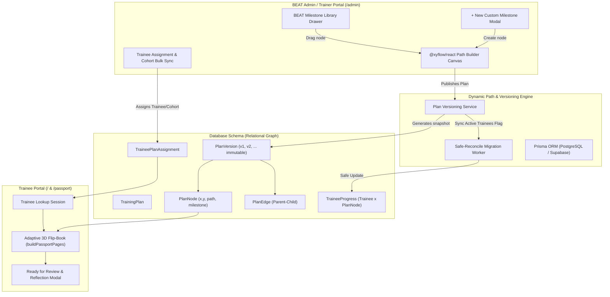

# Architectural Specification: Dynamic Role-Based Path Builder & Passport Sync
**Project:** The Bistro Group – Digital Growth Passport (BEAT Program)  
**Document:** `ARCHITECTURE-DYNAMIC-PATHS.md`  
**Status:** Approved & Ready for Implementation  
**Target Database:** PostgreSQL (Prisma ORM, Supabase-compatible) / SQLite for local testing  

---

## 1. Executive Summary & Vision

The Bistro Group's Growth Passport is transitioning from a static, 20-milestone universal training template (4 milestones per 5 development paths) to a **dynamic, role-based path builder**.

This architecture enables:
1. **Role-Tailored Plans**: Specialized training tracks for roles such as *Barista*, *Line Cook / Kitchen Staff*, *Floor Manager*, and *Corporate Intern*.
2. **Visual Drag-and-Drop Canvas**: An intuitive node-based builder built on `@xyflow/react`, styled with BEAT brand tokens (Maroon `#5C1D24` and Gold `#C29B38`).
3. **Two-Tier Tree Hierarchy**: Five permanent parent development path hubs (Onboarding, Communication, Technical, Culture, Leadership) connecting to child milestone nodes.
4. **Non-Blocking Trainee Discovery**: Trainees can explore milestones freely within their assigned role plan and request trainer verification without being artificially hard-locked.
5. **Safe-Reconcile Plan Versioning**: Modifying an active plan publishes an immutable version with an optional "Sync Active Trainees" setting that preserves all completed/in-review progress and soft-archives removed nodes.
6. **Adaptive 3D Flip-Book Engine**: Dynamic page budgeting maintaining the physical passport metaphor with 4 stamps/page, "Exempt for Role" seals for zero-node tracks, and spread-padded even page counts.

---

## 2. High-Level Architecture Diagram



---

## 3. Database Schema Specification (Prisma)

The dynamic path architecture introduces immutable plan versions and flexible node relationships while maintaining zero-mock strict typing.

```prisma
datasource db {
  provider = "sqlite" // Easily transitioned to "postgresql" for Supabase
  url      = env("DATABASE_URL")
}

generator client {
  provider = "prisma-client-js"
}

// ----------------------------------------------------
// 1. Core Users & Trainees
// ----------------------------------------------------

model AdminUser {
  id           String      @id @default(cuid())
  employeeId   String      @unique
  fullName     String
  email        String      @unique
  passwordHash String
  role         String      @default("TRAINER") // "TRAINER" | "ADMIN" | "SUPER_ADMIN"
  createdAt    DateTime    @default(now())
  updatedAt    DateTime    @updatedAt

  verifications       TraineeProgress[]
  authoredPlans       TrainingPlan[]
  publishedVersions   PlanVersion[]
  assignedTrainees    TraineePlanAssignment[]
}

model Trainee {
  id              String      @id @default(cuid())
  traineeCode     String      @unique // e.g. "TBG-2024-001"
  fullName        String
  email           String
  restaurantBrand String      // e.g. "TGI Fridays", "Italianni's", "Texas Roadhouse"
  branchLocation  String      // e.g. "BGC High Street", "Greenbelt"
  cohortBatch     String      // e.g. "Cohort-2024-Q4"
  jobRole         String?     // e.g. "Barista", "Line Cook", "Kitchen Staff"
  hireDate        DateTime
  createdAt       DateTime    @default(now())
  updatedAt       DateTime    @updatedAt

  planAssignments TraineePlanAssignment[]
  progressRecords TraineeProgress[]

  @@index([traineeCode, email])
  @@index([restaurantBrand, branchLocation, cohortBatch])
}

// ----------------------------------------------------
// 2. Master Milestone Catalog (Shared Library)
// ----------------------------------------------------

model MilestoneDefinition {
  id          String      @id @default(cuid())
  path        String      // "ONBOARDING" | "COMMUNICATION" | "TECHNICAL" | "CULTURE" | "LEADERSHIP"
  code        String      @unique // e.g. "ONB-01", "COMM-02"
  title       String
  description String
  isStandard  Boolean     @default(true) // Standard BEAT library vs ad-hoc
  createdAt   DateTime    @default(now())
  updatedAt   DateTime    @updatedAt

  planNodes   PlanNode[]
}

// ----------------------------------------------------
// 3. Dynamic Training Plans & Immutable Versions
// ----------------------------------------------------

model TrainingPlan {
  id              String      @id @default(cuid())
  title           String      // e.g. "Specialty Barista Training Track"
  roleIdentifier  String      // e.g. "BARISTA", "LINE_COOK", "IT_INTERN"
  restaurantBrand String?     // Nullable = applicable to all brands, or specific e.g. "TGI Fridays"
  description     String?
  isDefault       Boolean     @default(false)
  status          String      @default("DRAFT") // "DRAFT" | "PUBLISHED" | "ARCHIVED"
  createdById     String
  createdAt       DateTime    @default(now())
  updatedAt       DateTime    @updatedAt

  createdBy       AdminUser     @relation(fields: [createdById], references: [id])
  versions        PlanVersion[]

  @@index([roleIdentifier])
}

model PlanVersion {
  id              String      @id @default(cuid())
  planId          String
  versionNumber   Int         // 1, 2, 3...
  status          String      @default("PUBLISHED") // "DRAFT" | "PUBLISHED" | "SUPERSEDED"
  changelog       String?
  publishedById   String
  publishedAt     DateTime    @default(now())

  plan            TrainingPlan          @relation(fields: [planId], references: [id], onDelete: Cascade)
  publishedBy     AdminUser             @relation(fields: [publishedById], references: [id])
  nodes           PlanNode[]
  edges           PlanEdge[]
  assignments     TraineePlanAssignment[]

  @@unique([planId, versionNumber])
}

model PlanNode {
  id                  String               @id @default(cuid())
  planVersionId       String
  libraryMilestoneId  String?              // Null if custom-crafted on the canvas
  path                String               // "ONBOARDING" | "COMMUNICATION" | "TECHNICAL" | "CULTURE" | "LEADERSHIP"
  code                String               // e.g. "BAR-TECH-01"
  title               String
  description         String
  orderIndex          Int                  // Sort priority within the path
  posX                Float                // React Flow canvas coordinate X
  posY                Float                // React Flow canvas coordinate Y
  isCustom            Boolean              @default(false)
  createdAt           DateTime             @default(now())

  planVersion         PlanVersion          @relation(fields: [planVersionId], references: [id], onDelete: Cascade)
  libraryMilestone    MilestoneDefinition? @relation(fields: [libraryMilestoneId], references: [id], onDelete: SetNull)
  
  outgoingEdges       PlanEdge[]           @relation("SourceEdges")
  incomingEdges       PlanEdge[]           @relation("TargetEdges")
  progressRecords     TraineeProgress[]

  @@index([planVersionId, path])
}

model PlanEdge {
  id            String      @id @default(cuid())
  planVersionId String
  sourceNodeId  String
  targetNodeId  String
  edgeType      String      @default("PARENT_CHILD") // "PARENT_CHILD" | "SEQUENCE_HINT"

  planVersion   PlanVersion @relation(fields: [planVersionId], references: [id], onDelete: Cascade)
  sourceNode    PlanNode    @relation("SourceEdges", fields: [sourceNodeId], references: [id], onDelete: Cascade)
  targetNode    PlanNode    @relation("TargetEdges", fields: [targetNodeId], references: [id], onDelete: Cascade)

  @@unique([planVersionId, sourceNodeId, targetNodeId])
}

// ----------------------------------------------------
// 4. Trainee Assignments & Adaptive Progress
// ----------------------------------------------------

model TraineePlanAssignment {
  id            String      @id @default(cuid())
  traineeId     String
  planVersionId String
  assignedById  String
  assignedAt    DateTime    @default(now())
  status        String      @default("ACTIVE") // "ACTIVE" | "SUPERSEDED" | "ARCHIVED"

  trainee       Trainee     @relation(fields: [traineeId], references: [id], onDelete: Cascade)
  planVersion   PlanVersion @relation(fields: [planVersionId], references: [id], onDelete: Restrict)
  assignedBy    AdminUser   @relation(fields: [assignedById], references: [id])

  @@unique([traineeId, planVersionId])
  @@index([traineeId, status])
}

model TraineeProgress {
  id             String            @id @default(cuid())
  traineeId      String
  planNodeId     String
  status         String            @default("IN_PROGRESS") // "LOCKED" | "IN_PROGRESS" | "READY_FOR_REVIEW" | "VERIFIED" | "ARCHIVED"
  traineeNote    String?           // Reflection submitted when marking Ready for Review
  requestedAt    DateTime?
  
  verifiedBy     String?           // AdminUser ID
  verifiedAt     DateTime?
  trainerNote    String?
  
  // Archival flags for safe reconciliation
  isArchived     Boolean           @default(false)
  archivedReason String?           // "REMOVED_FROM_UPDATED_PLAN"

  createdAt      DateTime          @default(now())
  updatedAt      DateTime          @updatedAt

  trainee        Trainee           @relation(fields: [traineeId], references: [id], onDelete: Cascade)
  planNode       PlanNode          @relation(fields: [planNodeId], references: [id], onDelete: Restrict)
  verifier       AdminUser?        @relation(fields: [verifiedBy], references: [id])

  @@unique([traineeId, planNodeId])
  @@index([status])
}
```

---

## 4. Plan Modification & Safe Reconcile Cascading Engine

When an Admin edits a published plan, the system creates `PlanVersion` $(v+1)$.

```
   Admin Modifies Plan
          │
          ▼
   [Create PlanVersion v+1]
          │
          ├── Option A: "Draft Only" (No live impact)
          └── Option B: "Publish & Sync Active Trainees"
                                │
                                ▼
                 [Safe Reconcile Algorithm]
```

### Safe Reconcile Algorithm Rules:
1. **Preserve Completed & Pending Work (Zero Data Loss)**:
   - For every trainee assigned to $v$, if a node in $v$ was already `VERIFIED` or `READY_FOR_REVIEW`, that progress record is permanently preserved.
   - If the node's code/library ID exists in $v+1$, the `TraineeProgress` record is mapped directly to the new `PlanNode.id`.
   - If that milestone was deleted entirely from $v+1$, the record is flagged `isArchived = true` with `archivedReason = "REMOVED_FROM_UPDATED_PLAN"`. The trainee's completed stamps remain visible in an archival/endorsements section without lowering their active completion percentage.
2. **Injecting Newly Added Nodes**:
   - Any new `PlanNode` introduced in $v+1$ is automatically seeded into `TraineeProgress` for active trainees with status `IN_PROGRESS` (or `LOCKED` if prerequisite rules are active).
3. **Updating Modified Nodes**:
   - Updates to node descriptions, titles, or ordering reflect immediately on the trainee's passport upon version migration.
4. **Assignment Pointer Switch**:
   - The trainee's `TraineePlanAssignment` for version $v$ is marked `SUPERSEDED`, and a new assignment for $v+1$ is marked `ACTIVE`.

---

## 5. Frontend Canvas Architecture: React Flow & Responsive Design

### 5.1 Technology Stack
* **Library**: `@xyflow/react` (v12+) with `@dagrejs/dagre` for automated hierarchical layout.
* **Tokens**: 
  * Path Hubs: Deep Maroon (`#5C1D24`) with gold typography and track count badges.
  * Child Nodes: Crisp white cards (`#FFFFFF`) with Brand Gold (`#C29B38`) left accent borders and category indicator pills.
  * Edges: Smooth step bezier curves in `#C29B38` with animated strokes when hovered.

### 5.2 Two-Tier Tree Hierarchy on Canvas
The canvas initializes with 5 fixed **Development Path Root Hubs** positioned horizontally or clustered by track:
1. `PATH_ROOT_ONBOARDING`
2. `PATH_ROOT_COMMUNICATION`
3. `PATH_ROOT_TECHNICAL`
4. `PATH_ROOT_CULTURE`
5. `PATH_ROOT_LEADERSHIP`

Each child milestone node connects directly from its corresponding Path Root Hub.

```
 [ ONBOARDING HUB ]      [ TECHNICAL HUB ]      [ CULTURE HUB ]
         │                      │                      │
   ┌─────┴─────┐          ┌─────┴─────┐                │
[ONB-01]    [ONB-02]   [TECH-01]   [TECH-02]        [CUL-01]
```

### 5.3 Authoring Experience
* **Library Drawer (Right Slide-over)**: Searchable list of standard BEAT milestone cards. Trainers can drag a card onto the canvas; dropping it automatically links it to the closest Path Hub.
* **On-Canvas Add (`+`)**: Clicking `+ Add Milestone` on a Path Hub opens a modal to define a custom role-specific milestone (Code, Title, Description).
* **Auto-Layout Button**: Single click triggers Dagre auto-layout to rebalance node coordinates cleanly.
* **Responsive Dual-Mode**:
  * **Desktop & Tablet (`>= 768px`)**: Interactive zoom/pan visual node canvas with mini-map and node actions.
  * **Mobile (< 768px)**: Adaptive Tree/Accordion List view with drag-and-drop reordering handles and path grouping.

---

## 6. Adaptive 3D Flip-Book Engine (`PassportBook`)

### 6.1 The Dynamic Pagination Challenge
The physical passport flip-book requires:
* Even total page count (spread pairs: left page + right page).
* 5 standard development path order maintained regardless of role.
* Dynamically sized stamp pages per path (instead of fixed 6 pages per path).

### 6.2 The Algorithm (`buildDynamicPassportPages`)

1. **Cover & Profile Pages (Pages 1 & 2)**:
   - Page 1: Official BEAT Gold/Maroon Passport Cover.
   - Page 2: Trainee Profile (Name, Employee ID, Brand, Branch, Role, Assigned Plan Name & Version).
2. **Path Tracks (Tracks 1 to 5 in fixed sequence)**:
   - For each path:
     - **Track Overview Page**: Track title, description, verified count / total required count.
     - **Stamp Grid Pages (Density: 4 stamps per page)**:
       - If total nodes for path $N > 0$: $\lceil N / 4 \rceil$ stamp pages rendered in a 2x2 grid.
       - If $N == 0$ (Path exempt for this role): exactly **1 Stamp Page** rendered displaying an official gold BEAT watermark stamp: **"Exempt / N/A for Role"**.
3. **Spread Padding & Endorsements**:
   - After processing all 5 paths, calculate total pages $P$.
   - If $P \pmod 2 \ne 0$: Append 1 official "BEAT Trainer Notes & Endorsements" page.
   - If additional signature signatures are desired, pad with official BEAT memo spreads.

```typescript
export function buildDynamicPassportPages(
  paths: DynamicPathProgressSummary[],
  roleName: string
): PassportBookPage[] {
  const pages: PassportBookPage[] = [
    { number: 1, kind: "cover", milestones: [] },
    { number: 2, kind: "profile", milestones: [] },
  ];

  paths.forEach((path, trackIndex) => {
    // 1. Path Title Page
    pages.push({
      number: pages.length + 1,
      kind: "path",
      path,
      track: trackIndex + 1,
      milestones: [],
    });

    const ordered = [...path.milestones].sort((a, b) => a.orderIndex - b.orderIndex);

    if (ordered.length === 0) {
      // 2. Exempt Placeholder Stamp Page
      pages.push({
        number: pages.length + 1,
        kind: "exempt_stamp",
        path,
        track: trackIndex + 1,
        milestones: [],
      });
    } else {
      // 3. Dynamic 4-stamps per page
      const STAMPS_PER_PAGE = 4;
      const pageCount = Math.ceil(ordered.length / STAMPS_PER_PAGE);
      for (let i = 0; i < pageCount; i++) {
        pages.push({
          number: pages.length + 1,
          kind: "stamps",
          path,
          track: trackIndex + 1,
          milestones: ordered.slice(i * STAMPS_PER_PAGE, (i + 1) * STAMPS_PER_PAGE),
        });
      }
    }
  });

  // Ensure even spread count
  if (pages.length % 2 !== 0) {
    pages.push({
      number: pages.length + 1,
      kind: "notes_endorsements",
      milestones: [],
    });
  }

  return pages;
}
```

---

## 7. Trainee Progression & Discovery Semantics

1. **Free Exploration Model**:
   - Trainees are not linearly locked. They can navigate and complete any milestone assigned to their role.
   - Clicking any milestone allows immediate submission of a reflection note to request verification (`READY_FOR_REVIEW`).
2. **Trainer Verification**:
   - Admins see the role context and assigned plan version in the Review Queue.
   - Verification stamps the milestone with Trainer ID, timestamp, and trainer feedback note.

---

## 8. Implementation Backlog & Sprint Plan

### Epic 1: Database Migration & Relational Plan Models
- [ ] **Issue 1.1: Prisma Schema Migration for Dynamic Plans**
  - Add `TrainingPlan`, `PlanVersion`, `PlanNode`, `PlanEdge`, `TraineePlanAssignment`, and update `TraineeProgress`.
  - Create migration script ensuring backward-compatibility with existing seeded trainees.
- [ ] **Issue 1.2: Repository Layer for Dynamic Plans & Safe Reconcile**
  - Implement `/lib/db/repositories/plans.ts`: CRUD for plans, version publishing, node/edge persistence.
  - Implement safe reconcile logic: grandfather completed records, insert new nodes, soft-archive removed nodes.
- [ ] **Issue 1.3: Seed Update for Default Role Templates**
  - Create standard role templates: *Barista*, *Kitchen Staff*, *Floor Server*, *Store Supervisor*.

### Epic 2: Drag-and-Drop Path Builder Canvas (Admin Portal)
- [ ] **Issue 2.1: Install & Configure React Flow (`@xyflow/react`)**
  - Setup React Flow with BEAT theme styling, custom node types, and Dagre auto-layout.
- [ ] **Issue 2.2: Build Path Root Hub & Milestone Node Components**
  - Design custom `PathRootNode` (Maroon/Gold header) and `MilestoneNode` (interactive cards with edit/delete).
  - Implement two-tier connection logic (Path Root -> Child Milestone).
- [ ] **Issue 2.3: BEAT Milestone Library Slide-Over Drawer**
  - Searchable drawer of standard BEAT catalog milestones.
  - Drag-and-drop onto the canvas to attach to path hubs.
- [ ] **Issue 2.4: Custom Milestone Creation Modal**
  - Form to create on-the-fly custom milestones for specific roles with code auto-generation.
- [ ] **Issue 2.5: Responsive Tree Fallback for Mobile**
  - Accordion/list-based fallback view for screens < 768px.
- [ ] **Issue 2.6: Plan Publishing & Versioning Controls**
  - Publish modal with changelog input and "Sync Active Trainees" toggle.

### Epic 3: Trainee Assignment & Plan Synchronization
- [ ] **Issue 3.1: Trainee Registration & Assignment Update**
  - Update Trainee Creation form to select role-based Training Plan.
  - Add Bulk Plan Assignment tool in Trainee Directory table for cohort updates.
- [ ] **Issue 3.2: Trainee Passport Data Adapter**
  - Update `getTraineePassportViewData` to fetch the trainee's active assigned `PlanVersion` rather than the static 20-milestone template.

### Epic 4: Adaptive 3D Flip-Book Engine & Stamps
- [ ] **Issue 4.1: Dynamic Pagination Algorithm (`buildDynamicPassportPages`)**
  - Replace hardcoded 32-page generator with dynamic 4-stamp/page layout and even page padding.
- [ ] **Issue 4.2: Role "Exempt" Watermark Stamp Component**
  - Render authentic gold BEAT seal for paths that have 0 required milestones in a role.
- [ ] **Issue 4.3: Endorsements & Notes Spread Page**
  - Render an official BEAT Notes & Endorsements page for book padding and trainer remarks.

### Epic 5: Verification & End-to-End Testing
- [ ] **Issue 5.1: Admin Path Builder E2E Flow**
  - Create a custom "Barista" plan -> Publish version 1 -> Assign to test trainee -> Verify canvas layout.
- [ ] **Issue 5.2: Safe Reconcile E2E Test**
  - Mark trainee milestone verified -> Edit plan to version 2 (add node, delete verified node) -> Verify verified stamp remains intact and new node appears.
- [ ] **Issue 5.3: Flip-Book Visual Verification**
  - Inspect 3D turn animations with variable page counts (12, 16, 24, 32 pages).
