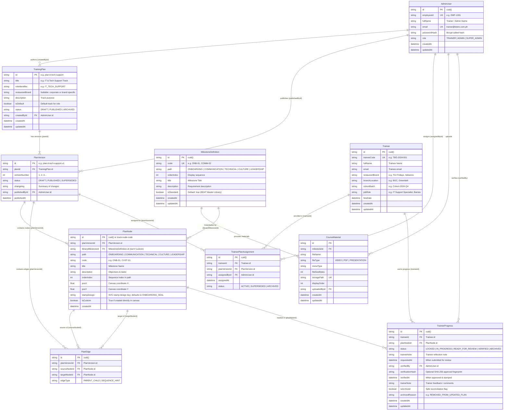

# The Bistro Group - Growth Passport Database Schema

This document provides the complete structural reference, entity definitions, and interactive visual ER Diagram for the Growth Passport database (currently running on SQLite via Prisma, drop-in compatible with Supabase PostgreSQL).

> [!IMPORTANT]
> **Maintainer Rule**: Whenever `prisma/schema.prisma` is modified (new models, altered fields, new relations), this file and the Mermaid diagram below MUST be updated immediately.

---

## 1. Visual Entity Relationship Diagram (ERD)

---

## 2. Entity Descriptions & Core Roles

### 1. `AdminUser`
- **Purpose**: Authenticated trainers, branch managers, and corporate BEAT administrators.
- **Key Relationships**: Authors training plans, publishes versioned plan releases, assigns tracks to trainees, and stamps/verifies completed milestones.

### 2. `Trainee`
- **Purpose**: Staff members progressing through the Growth Passport.
- **Key Relationships**: Bound to restaurant brand/branch and cohort batch. Has active `TraineePlanAssignment` records and tracks individual progress via `TraineeProgress`.

### 3. `MilestoneDefinition`
- **Purpose**: The master corporate catalog of standard BEAT competencies across the 5 development paths (`ONBOARDING`, `COMMUNICATION`, `TECHNICAL`, `CULTURE`, `LEADERSHIP`).
- **Key Relationships**: Serves as the template library that trainers pull onto the canvas as `PlanNode`.

### 4. `TrainingPlan`
- **Purpose**: High-level track container (e.g. "IT & Tech Support Track", "Specialty Barista Track").
- **Key Relationships**: Contains multiple `PlanVersion` entries (v1, v2 Draft, etc.) enabling non-destructive plan editing and version control.

### 5. `PlanVersion`
- **Purpose**: An immutable published snapshot or active draft containing a full graph of nodes and edges.
- **Key Relationships**: Trainees are assigned to a specific `PlanVersion`, guaranteeing that active trainees' requirements never change unexpectedly when trainers work on draft versions.

### 6. `PlanNode` & `PlanEdge`
- **Purpose**: The visual React Flow canvas graph structure. Nodes represent milestones (standard or custom-crafted), while edges represent sequence and prerequisite connections.
- **Key Attributes**: Stores canvas layout coordinates (`posX`, `posY`) and library linkage (`libraryMilestoneId`).

### 7. `TraineePlanAssignment`
- **Purpose**: Junction record associating a `Trainee` to an active `PlanVersion`.
- **Status lifecycle**: `ACTIVE` -> `SUPERSEDED` (when upgraded to a new published version) -> `ARCHIVED`.

### 8. `TraineeProgress`
- **Purpose**: The single source of truth for physical-to-digital Growth Passport stamps and review submissions.
- **Statuses**:
  - `LOCKED`: Prerequisite milestones pending.
  - `IN_PROGRESS`: Actively working on tasks.
  - `READY_FOR_REVIEW`: Self-marked with trainee reflection note.
  - `VERIFIED`: Formally confirmed by trainer with digital gold stamp, timestamp, and optional feedback.
  - `ARCHIVED`: Retained for audit trail if a plan version updates and drops a node.

---

## 3. Database Indexes & Constraints

| Model | Index / Constraint | Rationale |
| :--- | :--- | :--- |
| `Trainee` | `@@index([traineeCode, email])` | Ultra-fast passwordless login lookup |
| `Trainee` | `@@index([restaurantBrand, branchLocation, cohortBatch])` | High performance cohort filtering in Trainer Portal |
| `PlanVersion` | `@@unique([planId, versionNumber])` | Prevents duplicate version numbers for the same plan |
| `PlanNode` | `@@index([planVersionId, path])` | Rapid path-filtered queries when rendering the passport |
| `PlanEdge` | `@@unique([planVersionId, sourceNodeId, targetNodeId])` | Prevents duplicate edge links between nodes |
| `TraineePlanAssignment` | `@@unique([traineeId, planVersionId])` | Trainee cannot be assigned to the same version twice |
| `TraineeProgress` | `@@unique([traineeId, planNodeId])` | Guarantees strictly 1 progress record per trainee per node |
| `TraineeProgress` | `@@index([status])` | Instant query speed for Trainer Review Queue (`READY_FOR_REVIEW`) |

### Stamp audit fields

`PlanNode.stampDesign` persists the selected SVG design in each immutable version. New nodes default by development path in application persistence; the database fallback is `ONBOARDING_SEAL`. `TraineeProgress.verificationHash` records the SHA-256 fingerprint of trainee ID, original approved plan node ID, trainer ID, and the exact approval timestamp. Legacy approvals remain nullable. Reconciliation copies this original fingerprint without generating a new approval; it is a fingerprint, not a digital signature or proof against database tampering.

### CourseMaterial (shared milestone resources)

`MilestoneDefinition.materials` and `AdminUser.uploadedMaterials` link reusable
course resources to their library milestone and uploader. `storagePath` is unique;
`milestoneId` is indexed. File bytes live in the private Supabase `course-materials`
bucket, not PostgreSQL. Metadata is created only after object confirmation.
`displayOrder` controls presentation order. Signed read URLs expire in one hour.
Removing a library milestone cascades material metadata; application material
deletion removes Storage first, then metadata, preserving a retry path if Storage
fails. See `prisma/SUPABASE.md` for setup and orphan cleanup details.
