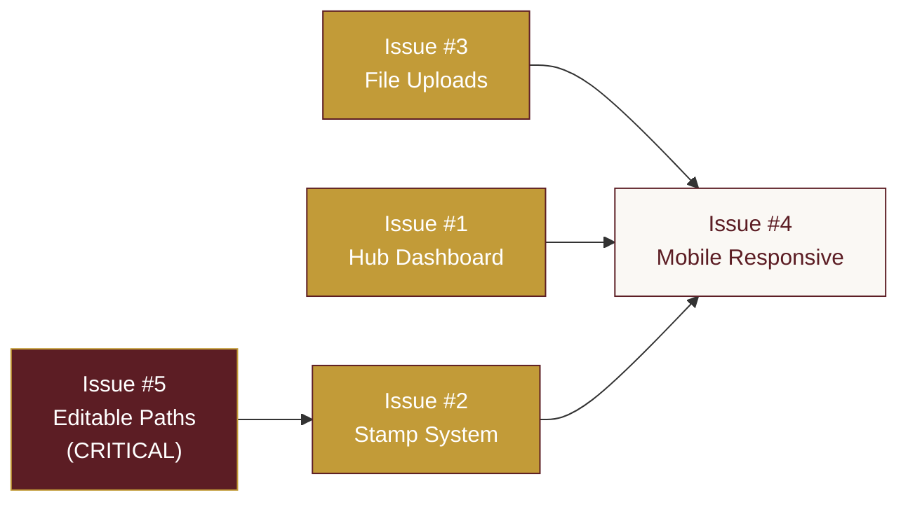

# GitHub Issues Backlog: BEAT Growth Passport Portal — Major Revision Round
**Project:** The Bistro Group – Digital Growth Passport (BEAT Program)  
**Generated:** 2026-10-23  
**Source:** [`REVISION-SPEC-BISTRO-PORTAL.md`](file:///Users/genesisjim/Codes/Passport-TBG/REVISION-SPEC-BISTRO-PORTAL.md)  
**Total Issues:** 5 (self-contained, assignable to Codex)

---

## Issue #1: Trainer Hub Dashboard with Cohort Heatmap & Floating Action Button

**Labels:** `feature`, `trainer-portal`, `ui/ux`, `priority:high`  
**Estimated Complexity:** Medium  
**Dependencies:** None (can start immediately)

### Description

Create a new unified trainer hub dashboard at `/trainer` that serves as the trainer's home screen. Currently, `/trainer` redirects to `/trainer/queue`. Replace this with a purpose-built hub page featuring a Trainee Cohort Progress Heatmap and a Floating Action Button (FAB) with quick actions.

### Technical Instructions

#### 1. Create Hub Dashboard Page
- **File:** `app/trainer/page.tsx` (replace existing redirect)
- Fetch aggregated data via a new server action `getHubDashboardDataAction` in `lib/actions/dashboard.ts`
- Data query: For each unique `(restaurantBrand, cohortBatch)` pair, calculate the average completion percentage across all active trainees in that cohort
- Completion % = `(VERIFIED milestones / total assigned milestones) × 100` per trainee, averaged across the cohort

#### 2. Create Cohort Progress Heatmap Component
- **File:** `components/admin/CohortProgressHeatmap.tsx`
- Visual grid layout: Rows = restaurant brands, Columns = cohort batches
- Each cell shows completion percentage with color intensity:
  - `0-25%`: light warm tone
  - `26-50%`: Brand Gold at 40% opacity
  - `51-75%`: Brand Gold at 70% opacity
  - `76-100%`: Brand Gold at 100% opacity with Brand Maroon text
- Clicking a cell navigates to `/trainer/trainees?brand={brand}&cohort={cohort}` (filtered view)
- On `< lg` breakpoints: collapse to a simplified sorted list view (brand → cohort → percentage)

#### 3. Create Repository Function
- **File:** `lib/db/repositories/dashboard.ts`
- **Function:** `getCohortProgressHeatmap(): Promise<CohortHeatmapData[]>`
- Query joins: `Trainee` → `TraineePlanAssignment` (status=ACTIVE) → `PlanVersion` → `PlanNode` → `TraineeProgress`
- Group by `restaurantBrand` and `cohortBatch`
- Return: `{ brand: string, cohort: string, avgCompletionPct: number, traineeCount: number }[]`

#### 4. Create Floating Action Button (FAB)
- **File:** `components/admin/FloatingActionButton.tsx`
- Position: Fixed bottom-right (`bottom-6 right-6`)
- Default state: Circular button, Brand Gold `#C29B38` background, white `Plus` icon (Lucide)
- Expanded state: Stacked vertical menu above the FAB with 3 action items:
  - **+ New Course** → Navigate to `/trainer/plans` and open `CreatePlanModal`
  - **+ Register Trainee** → Navigate to `/trainer/trainees/new`
  - **+ Batch Sign-Off** → Navigate to `/trainer/batch`
- Each menu item: Brand Maroon `#5C1D24` background, white text, rounded-lg, with matching Lucide icon
- Animation: Menu items slide up with staggered entrance (50ms delay each)
- Dismiss: Click outside or re-tap FAB
- FAB is rendered in `app/trainer/layout.tsx` so it appears on ALL trainer pages

#### 5. Add Inline Expansion to Existing List Views
- **Files:** `components/admin/QueueItemCard.tsx`, `components/admin/TraineeFilterTable.tsx`
- Add accordion expand/collapse behavior: clicking a row expands an inline detail panel below it
- Detail panel shows full trainee info, milestone details, and action buttons (approve, view passport)
- No page navigation required for common actions

### Acceptance Criteria
- [ ] `/trainer` renders the hub dashboard (not a redirect to `/trainer/queue`)
- [ ] Heatmap displays accurate completion percentages grouped by brand × cohort
- [ ] Heatmap cells are clickable and navigate to filtered trainee views
- [ ] Heatmap degrades to a list view on `< lg` screens
- [ ] FAB is visible on all `/trainer/*` routes
- [ ] FAB expands to show 3 action items with correct navigation targets
- [ ] FAB uses Brand Gold `#C29B38` (not blue or purple)
- [ ] FAB dismisses on outside click
- [ ] Inline expansion works on queue items and trainee table rows
- [ ] All existing trainer navigation links still work
- [ ] No new npm dependencies added

### Files to Create/Modify
```
CREATE: app/trainer/page.tsx (replace redirect with hub dashboard)
CREATE: components/admin/CohortProgressHeatmap.tsx
CREATE: components/admin/FloatingActionButton.tsx
CREATE: lib/db/repositories/dashboard.ts
CREATE: lib/actions/dashboard.ts
MODIFY: app/trainer/layout.tsx (add FAB to layout)
MODIFY: components/admin/QueueItemCard.tsx (add inline expansion)
MODIFY: components/admin/TraineeFilterTable.tsx (add inline expansion)
```

---

## Issue #2: Digital Stamping System with SVG Stamps, SHA-256 Hash & Rich Tooltips

**Labels:** `feature`, `stamps`, `passport`, `security`, `priority:high`  
**Estimated Complexity:** Medium  
**Dependencies:** None (can start immediately)

### Description

Implement a complete digital stamping system with SVG-based stamp designs per development path, SHA-256 verification hashes generated at stamp time, and rich tooltips showing full audit metadata. Add a stamp design picker to the canvas builder and a 30-second polling mechanism for near-real-time stamp sync to the trainee's 3D passport.

### Technical Instructions

#### 1. Database Migration
- **File:** `prisma/schema.prisma`
- Add `stampDesign String @default("ONBOARDING_SEAL")` to the `PlanNode` model
- Add `verificationHash String?` to the `TraineeProgress` model
- Run `npx prisma migrate dev --name add-stamp-design-and-verification-hash`
- **Update** `DATABASE_SCHEMA.md` with the new fields and update the Mermaid ER diagram

#### 2. Create Stamp Design Catalog
- **File:** `lib/stamps/catalog.ts`
- Define `STAMP_DESIGNS` as a const object mapping design keys to visual metadata:
  ```typescript
  export const STAMP_DESIGNS = {
    ONBOARDING_SEAL:      { label: "Onboarding",     icon: "BookOpen",       borderPattern: "dotted-circle",  accentColor: "#C29B38" },
    COMMUNICATION_BADGE:  { label: "Communication",   icon: "MessageCircle",  borderPattern: "speech-bubble",  accentColor: "#C29B38" },
    TECHNICAL_GEAR:       { label: "Technical",        icon: "Wrench",         borderPattern: "gear-teeth",     accentColor: "#C29B38" },
    CULTURE_STAR:         { label: "Culture",          icon: "Star",           borderPattern: "star-burst",     accentColor: "#C29B38" },
    LEADERSHIP_CREST:     { label: "Leadership",       icon: "Crown",          borderPattern: "shield",         accentColor: "#C29B38" },
    BARISTA_BADGE:        { label: "Barista",          icon: "Coffee",         borderPattern: "cup-ring",       accentColor: "#C29B38" },
    KITCHEN_BADGE:        { label: "Kitchen",          icon: "ChefHat",        borderPattern: "flame",          accentColor: "#C29B38" },
    SERVICE_BADGE:        { label: "Service",          icon: "Heart",          borderPattern: "ribbon",         accentColor: "#C29B38" },
  } as const;
  export type StampDesignKey = keyof typeof STAMP_DESIGNS;
  ```

#### 3. Create SVG Stamp Component
- **File:** `components/passport/PassportStampSVG.tsx`
- Renders an inline SVG stamp with:
  - Circular/shaped border using the design's `borderPattern`
  - Center Lucide icon matching the design's `icon`
  - Brand Gold accent color
  - Verified state: full opacity + Brand Maroon fill
  - Unverified state: ghosted/outlined at 25% opacity
- Size: 80×80px default, responsive scaling

#### 4. Implement SHA-256 Verification Hash
- **File:** `lib/stamps/hash.ts`
- ```typescript
  import { createHash } from "crypto";
  export function generateVerificationHash(traineeId: string, planNodeId: string, verifiedBy: string, verifiedAt: Date): string {
    const payload = `${traineeId}:${planNodeId}:${verifiedBy}:${verifiedAt.toISOString()}`;
    return createHash("sha256").update(payload).digest("hex");
  }
  ```
- **Modify** the verification flow in `lib/actions/progress.ts` (or wherever `verifyMilestoneAction` lives):
  - At verification time, generate the hash and store it in `TraineeProgress.verificationHash`
  - Also store `verifiedBy`, `verifiedAt`, and `trainerNote` as before

#### 5. Create Rich Stamp Tooltip Component
- **File:** `components/passport/StampDetailTooltip.tsx`
- Custom Tailwind popover (no external library) positioned above or below the stamp
- Trigger: Hover on desktop, tap on mobile
- Fields displayed:
  1. Trainer name (from `AdminUser.fullName` via `verifiedBy` FK)
  2. Verification date/time (formatted: "Oct 23, 2026 at 10:30 AM")
  3. Truncated hash (first 8 chars of `verificationHash`, monospace font)
  4. Milestone code + title (e.g., "ONB-01: Company Orientation")
  5. Trainee reflection note (if present, italic, truncated to 2 lines)
  6. Trainer feedback note (if present, truncated to 2 lines)
- Styling: White card, Brand Maroon text, thin Brand Gold border, subtle shadow

#### 6. Add Stamp Design Picker to Canvas Builder
- **File:** `components/canvas/StampDesignPicker.tsx`
- Grid of stamp design thumbnails (from `STAMP_DESIGNS` catalog)
- Appears in the `MilestoneNode` edit panel or `EditMilestoneModal`
- Selected design stored in PlanNode's `stampDesign` field
- Default selection auto-derived from the node's `path` value

#### 7. Implement 30-Second Stamp Polling on Trainee Dashboard
- **File:** `lib/hooks/useStampPolling.ts`
- Custom React hook:
  ```typescript
  export function useStampPolling(traineeId: string, lastKnownTimestamp: string) {
    // 30-second setInterval
    // Calls checkForNewStampsAction(traineeId, lastKnownTimestamp)
    // If new stamps found: router.refresh() + show toast
  }
  ```
- **File:** `lib/actions/progress.ts` — add `checkForNewStampsAction`:
  ```typescript
  export async function checkForNewStampsAction(traineeId: string, since: string): Promise<{ hasNew: boolean }> {
    const count = await prisma.traineeProgress.count({
      where: { traineeId, status: "VERIFIED", verifiedAt: { gt: new Date(since) } }
    });
    return { hasNew: count > 0 };
  }
  ```
- **File:** `components/trainee/StampNotificationToast.tsx` — simple custom toast: "🎉 New stamp earned!" with auto-dismiss
- Wire the polling hook into `app/trainee/dashboard/page.tsx` or `TraineeDashboard.tsx`

#### 8. Update Plan Version Persistence
- **Modify:** `lib/actions/plans.ts` — `savePlanVersionAction` and `publishPlanCanvasAction`
- Include `stampDesign` field when persisting `PlanNode` records
- **Modify:** `lib/db/repositories/plans.ts` — include `stampDesign` in node create/update queries

### Acceptance Criteria
- [ ] `PlanNode.stampDesign` field exists in schema and migrated
- [ ] `TraineeProgress.verificationHash` field exists in schema and migrated
- [ ] `DATABASE_SCHEMA.md` updated with new fields and ER diagram
- [ ] SVG stamps render with distinct visual designs per `StampDesignKey`
- [ ] Verified stamps show full opacity; unverified stamps show ghosted outline
- [ ] SHA-256 hash is generated and stored at verification time
- [ ] Stamp tooltip displays all 6 metadata fields correctly
- [ ] Tooltip appears on hover (desktop) and tap (mobile)
- [ ] Stamp design picker appears in the canvas builder milestone edit flow
- [ ] Default stamp design auto-derived from path if not explicitly set
- [ ] 30-second polling detects new stamps and triggers dashboard refresh
- [ ] Toast notification appears when new stamp is detected
- [ ] No new npm dependencies (crypto is Node.js built-in)

### Files to Create/Modify
```
MODIFY: prisma/schema.prisma (add stampDesign to PlanNode, verificationHash to TraineeProgress)
MODIFY: DATABASE_SCHEMA.md (update schema docs + ER diagram)
CREATE: lib/stamps/catalog.ts
CREATE: lib/stamps/hash.ts
CREATE: components/passport/PassportStampSVG.tsx
CREATE: components/passport/StampDetailTooltip.tsx
CREATE: components/canvas/StampDesignPicker.tsx
CREATE: lib/hooks/useStampPolling.ts
CREATE: components/trainee/StampNotificationToast.tsx
MODIFY: lib/actions/progress.ts (add hash generation + checkForNewStampsAction)
MODIFY: lib/actions/plans.ts (include stampDesign in node persistence)
MODIFY: lib/db/repositories/plans.ts (include stampDesign in queries)
MODIFY: components/passport/PassportStamp.tsx (use new SVG stamp component)
MODIFY: components/passport/MilestoneCard.tsx (integrate tooltip)
MODIFY: app/trainee/dashboard/page.tsx (wire polling hook)
```

---

## Issue #3: Drag-and-Drop Course Material Upload with Supabase Storage

**Labels:** `feature`, `file-upload`, `supabase`, `course-builder`, `priority:high`  
**Estimated Complexity:** High  
**Dependencies:** None (can start immediately, but pairs well with Issue #2 stamp system)

### Description

Implement a non-technical drag-and-drop course material upload system. Trainers can upload MP4 videos, PDFs, and PPTX presentations to milestones in the BEAT library. Files are stored in Supabase Storage with signed URLs for secure trainee access. Includes a preview modal for viewing uploaded materials before publishing.

### Technical Instructions

#### 1. Install Supabase Client
```bash
npm install @supabase/supabase-js
```

#### 2. Database Migration
- **File:** `prisma/schema.prisma`
- Add `CourseMaterial` model (see spec for full schema)
- Add `materials CourseMaterial[]` relation to `MilestoneDefinition`
- Add `uploadedMaterials CourseMaterial[]` relation to `AdminUser`
- Run `npx prisma migrate dev --name add-course-materials`
- **Update** `DATABASE_SCHEMA.md` with the new model and relations

#### 3. Create Supabase Client Utilities
- **File:** `lib/supabase/client.ts`
  ```typescript
  import { createClient } from "@supabase/supabase-js";
  export const supabaseBrowser = createClient(
    process.env.NEXT_PUBLIC_SUPABASE_URL!,
    process.env.NEXT_PUBLIC_SUPABASE_ANON_KEY!
  );
  ```
- **File:** `lib/supabase/server.ts`
  ```typescript
  import { createClient } from "@supabase/supabase-js";
  export const supabaseAdmin = createClient(
    process.env.NEXT_PUBLIC_SUPABASE_URL!,
    process.env.SUPABASE_SERVICE_ROLE_KEY!
  );
  ```

#### 4. Create File Validation Utilities
- **File:** `lib/validations/materials.ts`
- Define `MATERIAL_LIMITS` constant with max sizes and MIME types per file type:
  - `VIDEO`: MP4, 500MB max
  - `PDF`: PDF, 50MB max
  - `PRESENTATION`: PPTX, 100MB max
- Export `validateFile(file: File)` function for client-side validation
- Export Zod schema `uploadRequestSchema` for server-side validation

#### 5. Create Material Repository Functions
- **File:** `lib/db/repositories/materials.ts`
- `createCourseMaterial(data): Promise<CourseMaterial>` — Prisma create
- `deleteCourseMaterial(id): Promise<{ storagePath: string }>` — Prisma delete, returns path for Storage cleanup
- `getMaterialsForMilestone(milestoneId): Promise<CourseMaterial[]>` — Ordered by `displayOrder`
- `reorderMaterials(milestoneId, orderedIds: string[]): Promise<void>` — Batch update `displayOrder`

#### 6. Create Material Server Actions
- **File:** `lib/actions/materials.ts`
- **`requestUploadUrlAction(input)`**: 
  - Validates admin session
  - Validates file metadata (size, MIME type) via Zod
  - Generates `storagePath`: `{milestoneCode}/{cuid()}/{sanitizedFileName}`
  - Calls `supabaseAdmin.storage.from('course-materials').createSignedUploadUrl(storagePath)`
  - Returns `{ signedUrl, storagePath, materialId, token }`
- **`confirmUploadAction(input)`**:
  - Validates admin session
  - Creates `CourseMaterial` record in Prisma with the confirmed storage path
  - Revalidates relevant paths
  - Returns the created material record
- **`deleteMaterialAction(materialId)`**:
  - Validates admin session
  - Deletes Prisma record (gets `storagePath`)
  - Calls `supabaseAdmin.storage.from('course-materials').remove([storagePath])`
  - Revalidates relevant paths
- **`getMaterialSignedUrlAction(materialId)`**:
  - Validates trainee OR admin session
  - Fetches `CourseMaterial.storagePath` from Prisma
  - Calls `supabaseAdmin.storage.from('course-materials').createSignedUrl(storagePath, 3600)` (1-hour expiry)
  - Returns `{ signedUrl }`

#### 7. Create Drag-and-Drop Upload Zone Component
- **File:** `components/admin/MaterialUploadZone.tsx`
- Props: `milestoneId: string`, `milestoneCode: string`, `onUploadComplete: (material) => void`
- UI: Dashed border drop zone with file type icons and "Drag files here or click to browse" text
- Client-side flow:
  1. User drops file or selects via file picker
  2. Client validates file with `validateFile()` — show error toast if invalid
  3. Client calls `requestUploadUrlAction` to get signed upload URL
  4. Client streams file directly to Supabase using `fetch(signedUrl, { method: 'PUT', body: file })`
  5. During upload: show `UploadProgressBar` component with percentage
  6. On success: client calls `confirmUploadAction` to record in Prisma
  7. On complete: callback `onUploadComplete` triggers list refresh
- Supports multiple files: queue uploads sequentially

#### 8. Create Upload Progress Bar Component
- **File:** `components/admin/UploadProgressBar.tsx`
- Shows file name, file type icon, upload percentage bar, and cancel button
- Progress tracked via `XMLHttpRequest` (for upload progress events) or `fetch` with ReadableStream
- Colors: Brand Gold `#C29B38` progress fill, Brand Maroon text

#### 9. Create Material Preview Modal
- **File:** `components/admin/MaterialPreviewModal.tsx`
- Full-width modal overlay (`max-w-4xl`)
- Header: File name, type badge, file size, upload date
- Preview area by type:
  - **MP4**: `<video controls>` element with signed URL as `src`
  - **PDF**: `<iframe>` element with signed URL as `src`, 100% height
  - **PPTX**: File metadata card with download button (no native preview)
- Footer: Download button, Delete button (admin only, with confirmation), Close button
- Signed URL fetched via `getMaterialSignedUrlAction` when modal opens

#### 10. Create Material List Panel Component
- **File:** `components/admin/MaterialListPanel.tsx`
- Renders within the milestone detail view (inline expansion or edit modal)
- Ordered list of attached materials with:
  - File type icon (Lucide: `Video`, `FileText`, `Presentation`)
  - File name (truncated)
  - File size (formatted: "12.5 MB")
  - Preview button → opens `MaterialPreviewModal`
  - Delete button (with confirmation)
- Empty state: "No materials attached. Drag files here to upload."
- Includes `MaterialUploadZone` at the bottom for adding more

#### 11. Integrate into Canvas Builder
- **Modify:** `components/canvas/nodes/MilestoneNode.tsx` — Add material count badge and "Attach Materials" button
- **Modify:** `components/canvas/EditMilestoneModal.tsx` — Add `MaterialListPanel` tab/section
- Clicking "Attach Materials" on a MilestoneNode opens the edit modal with material panel focused

#### 12. Integrate into Trainee View
- **Modify:** `components/trainee/ModuleDetails.tsx` or `components/passport/MilestoneCard.tsx`
- When a trainee views a milestone, show attached materials as viewable/downloadable links
- Each material link calls `getMaterialSignedUrlAction` to get a fresh signed URL
- Video materials render inline `<video>` player
- PDF materials open in new tab via signed URL

### Acceptance Criteria
- [ ] `@supabase/supabase-js` installed as dependency
- [ ] `CourseMaterial` model exists in schema and migrated
- [ ] `DATABASE_SCHEMA.md` updated with new model
- [ ] Supabase client utilities created for both browser and server
- [ ] File validation enforces: MP4 ≤ 500MB, PDF ≤ 50MB, PPTX ≤ 100MB
- [ ] Invalid file types show clear error message
- [ ] Upload flow: drag-drop → validate → signed URL → direct upload → confirm
- [ ] Progress bar shows real percentage during upload
- [ ] Preview modal renders MP4 via `<video>`, PDF via `<iframe>`, PPTX as download card
- [ ] Delete removes both Prisma record and Supabase Storage file
- [ ] Trainee view shows attached materials with signed URL access
- [ ] Signed URLs expire after 1 hour
- [ ] Material upload zone appears in canvas builder milestone edit flow
- [ ] Multiple files can be uploaded sequentially
- [ ] Brand colors used throughout (no generic blue/purple)

### Files to Create/Modify
```
MODIFY: package.json (add @supabase/supabase-js)
MODIFY: prisma/schema.prisma (add CourseMaterial model + relations)
MODIFY: DATABASE_SCHEMA.md
CREATE: lib/supabase/client.ts
CREATE: lib/supabase/server.ts
CREATE: lib/validations/materials.ts
CREATE: lib/db/repositories/materials.ts
CREATE: lib/actions/materials.ts
CREATE: components/admin/MaterialUploadZone.tsx
CREATE: components/admin/UploadProgressBar.tsx
CREATE: components/admin/MaterialPreviewModal.tsx
CREATE: components/admin/MaterialListPanel.tsx
MODIFY: components/canvas/nodes/MilestoneNode.tsx (add material badge/button)
MODIFY: components/canvas/EditMilestoneModal.tsx (add material panel)
MODIFY: components/trainee/ModuleDetails.tsx (show materials to trainees)
MODIFY: components/passport/MilestoneCard.tsx (show material indicators)
```

---

## Issue #4: Mobile-First Responsive Layout & Click-Depth Reduction

**Labels:** `feature`, `responsive`, `ui/ux`, `mobile`, `priority:medium`  
**Estimated Complexity:** Medium  
**Dependencies:** Issues #1 and #2 should ideally be in progress or complete (this issue styles their components)

### Description

Implement fully adaptive mobile-first layouts across the entire portal. The 3D passport flip-book degrades to a vertical scrollable card stack on mobile. The canvas builder degrades to an accordion tree view. All list views get inline expansion instead of page navigation. Navigation is optimized for minimum click depth on all screen sizes.

### Technical Instructions

#### 1. Establish Responsive Breakpoint Constants
- **Reference:** Tailwind's default breakpoints: `sm:640`, `md:768`, `lg:1024`, `xl:1280`
- All new CSS written mobile-first (base styles = mobile, progressively enhanced)

#### 2. 3D Passport Flip-Book Mobile Degradation
- **File:** `components/passport/PassportBook.tsx`
- `≥ md` (768px+): Current interactive 3D page-turning flip-book
- `< md`: Vertical scrollable stack of passport page cards
  - Each "page" rendered as a full-width card with rounded corners and subtle shadow
  - Stamp grid still 2×2 within each card
  - Path overview pages become section dividers with colored headers
  - Cover page becomes a compact header bar
- Use `useMediaQuery` hook or Tailwind responsive classes
- Scroll snap optional: `scroll-snap-type: y mandatory` on the container

#### 3. Canvas Builder Mobile Degradation
- **File:** `components/canvas/PlanCanvasBuilder.tsx`
- `≥ md`: Interactive `@xyflow/react` canvas with zoom, pan, minimap
- `< md`: Accordion tree view
  - **File:** `components/canvas/PlanTreeView.tsx` (may already exist — enhance it)
  - 5 collapsible path sections (ONBOARDING, COMMUNICATION, etc.)
  - Each section lists milestones as sortable cards with drag handles
  - Tap a milestone card to expand inline with edit fields
  - Use CSS `order` property or state management for reordering
  - "Add Milestone" button within each path section
- Conditional rendering based on screen width via `useEffect` + `window.matchMedia('(min-width: 768px)')`

#### 4. Trainee Dashboard Mobile Layout
- **File:** `components/trainee/TraineeDashboard.tsx`
- `≥ md`: Current grid layout with path progress cards
- `< md`: Single column stack
  - Path progress cards full width
  - Completion stats in a compact horizontal scrollable chip row
  - Profile info collapsed into a tappable header bar

#### 5. Trainer Navigation Mobile Optimization
- **File:** `components/admin/AdminNavigation.tsx`
- Current: Horizontal nav with tabs that overflow-scroll on mobile
- Enhancement:
  - `< md`: Bottom navigation bar (fixed to viewport bottom) with icon-only buttons for Verifications, Plans, Trainees, and Hub
  - `≥ md`: Keep current top navigation bar
  - Active state: Brand Gold underline/dot indicator
  - FAB (from Issue #1) positioned above the bottom nav on mobile

#### 6. List View Inline Expansion (All Platforms)
- **File:** `components/admin/TraineeFilterTable.tsx`
  - Table rows become cards on `< md`
  - Tap to expand shows: trainee details, assigned plan, completion bar, quick actions
- **File:** `components/admin/QueueItemCard.tsx`
  - Already card-based — ensure full-width on mobile
  - Inline expansion shows: milestone details, trainee reflection, 1-click approve button
- **File:** `components/admin/VerificationHub.tsx`
  - Responsive grid: 2 columns on `≥ lg`, 1 column on `< lg`

#### 7. Modal/Drawer Responsive Behavior
- All existing modals (`CreatePlanModal`, `EditMilestoneModal`, `AssignPlanModal`, etc.):
  - `≥ md`: Centered modal overlay with `max-w-lg`
  - `< md`: Full-screen bottom sheet (slides up from bottom, rounded top corners)
  - Close button prominent in top-right
  - Form inputs appropriately sized for touch (min 44px tap targets)

#### 8. Typography & Spacing Responsive Tokens
- Ensure all headings, body text, and spacing scale appropriately:
  - `< md`: Slightly larger tap targets (min `h-11`), reduced padding
  - Page headers: `text-xl` on mobile, `text-2xl` on desktop
  - Card padding: `p-3` on mobile, `p-5` on desktop

### Acceptance Criteria
- [ ] Passport flip-book shows interactive 3D turning on `≥ md`, scrollable cards on `< md`
- [ ] Canvas builder shows React Flow on `≥ md`, accordion tree on `< md`
- [ ] Trainee dashboard stacks to single column on mobile
- [ ] Bottom navigation bar appears on trainer portal at `< md` widths
- [ ] Top navigation bar remains on `≥ md`
- [ ] FAB positioned correctly above bottom nav on mobile
- [ ] Table views degrade to card lists on mobile
- [ ] All modals become bottom sheets on mobile
- [ ] Minimum 44px touch targets on all interactive elements
- [ ] No horizontal scroll on any page at any breakpoint
- [ ] Brand colors (Maroon `#5C1D24`, Gold `#C29B38`) maintained across all responsive views
- [ ] No new npm dependencies

### Files to Create/Modify
```
MODIFY: components/passport/PassportBook.tsx (mobile card stack)
MODIFY: components/canvas/PlanCanvasBuilder.tsx (conditional rendering)
MODIFY: components/canvas/PlanTreeView.tsx (enhance mobile accordion)
MODIFY: components/trainee/TraineeDashboard.tsx (mobile layout)
MODIFY: components/admin/AdminNavigation.tsx (bottom nav on mobile)
MODIFY: components/admin/TraineeFilterTable.tsx (card layout on mobile)
MODIFY: components/admin/QueueItemCard.tsx (inline expansion)
MODIFY: components/admin/VerificationHub.tsx (responsive grid)
MODIFY: components/admin/CreatePlanModal.tsx (bottom sheet on mobile)
MODIFY: components/admin/AssignPlanModal.tsx (bottom sheet on mobile)
MODIFY: components/canvas/EditMilestoneModal.tsx (bottom sheet on mobile)
MODIFY: components/canvas/CreateMilestoneModal.tsx (bottom sheet on mobile)
MODIFY: components/canvas/PublishPlanModal.tsx (bottom sheet on mobile)
CREATE: lib/hooks/useMediaQuery.ts (if not exists)
```

---

## Issue #5: Editable Learning Paths with Non-Destructive Progress Preservation

**Labels:** `feature`, `canvas`, `data-integrity`, `critical`, `priority:critical`  
**Estimated Complexity:** Medium  
**Dependencies:** None (uses existing reconcile engine)

### Description

Enable admins to rename development paths, rearrange milestone sequences via the existing React Flow canvas, and add/remove milestones from published plans — all while preserving existing trainee progress through the already-implemented safe reconciliation engine. This is a **critical data integrity** requirement.

### Technical Instructions

#### 1. Inline Path Renaming on Canvas
- **File:** `components/canvas/nodes/PathRootNode.tsx`
- Add double-click-to-edit behavior on the path hub title:
  - Default: Static text display (e.g., "TECHNICAL SKILLS")
  - Double-click: Switches to an inline `<input>` field pre-filled with current name
  - Enter/blur: Saves the new name to canvas state (updates all child PlanNodes' `path` field in local state)
  - Escape: Cancels edit
- The rename is stored in local canvas state and persisted when the plan version is saved/published
- Visual indicator: Pencil icon on hover to signal editability

#### 2. Milestone Reordering via Canvas Drag
- **File:** `components/canvas/PlanCanvasBuilder.tsx`
- Current behavior: Nodes can be dragged anywhere on the canvas (free positioning)
- Enhancement: When a milestone node is dragged and dropped near a different position within the same path group:
  - Auto-recalculate `orderIndex` for all nodes in that path group
  - Trigger Dagre re-layout to reflect the new visual order
  - Order changes persisted in the `PlanNode.orderIndex` field
- Implementation: After `onNodeDragStop`, sort nodes by Y position within each path group and assign sequential `orderIndex` values

#### 3. Add Milestone to Existing Path
- **File:** `components/canvas/nodes/PathRootNode.tsx`
- Ensure the `+ Add Milestone` button on each path root hub works correctly:
  - Opens `CreateMilestoneModal` pre-filled with the path value
  - New milestone node added to canvas with correct `path` assignment
  - Auto-connected to the path root hub via `PlanEdge`
  - `orderIndex` set to `max(existing) + 1`

#### 4. Remove Milestone from Path
- **File:** `components/canvas/nodes/MilestoneNode.tsx`
- Ensure the delete button on milestone nodes:
  - Removes the node from canvas state
  - Removes all connected edges
  - Shows a warning if the milestone has existing trainee progress:
    > "⚠️ X trainees have progress on this milestone. Their completed stamps will be preserved in archived status when this version is published."
  - Does NOT delete `TraineeProgress` records — that's handled by the reconcile engine at publish time

#### 5. Verify Reconcile Engine Handles All Edit Scenarios

The existing [`reconcileTraineeToPlanVersion`](file:///Users/genesisjim/Codes/Passport-TBG/lib/db/services/reconcile.ts#L18-L196) already handles:
- ✅ **Node matched (same code/libraryMilestoneId)**: Progress remapped to new version's node
- ✅ **Node deleted**: Progress soft-archived with `archivedReason: "REMOVED_FROM_UPDATED_PLAN"`
- ✅ **New node added**: Fresh `TraineeProgress` created with `IN_PROGRESS` status
- ✅ **Assignment pointer switch**: Old assignment → `SUPERSEDED`, new assignment → `ACTIVE`

**Verify and test** that the following edge cases work correctly:
1. **Path rename + reconcile**: Rename "TECHNICAL" to "OPERATIONS" in v2 → Trainee's verified stamps on TECHNICAL milestones transfer to OPERATIONS nodes (matched by code)
2. **Reorder + reconcile**: Swap order of ONB-01 and ONB-02 → Progress preserved on both (matched by code, order is cosmetic)
3. **Bulk edit**: Rename path + add 2 milestones + remove 1 milestone in a single version bump → All 3 operations reconcile correctly
4. **Empty path**: Remove all milestones from a path → Path shows "Exempt for Role" in trainee passport

#### 6. Publish Version with Edit Summary
- **File:** `components/canvas/PublishPlanModal.tsx`
- Enhance the publish modal to show a diff summary before publishing:
  - "📝 Changes in this version:"
  - List of renamed paths (old name → new name)
  - List of added milestones (with codes)
  - List of removed milestones (with codes + warning about archive)
  - List of reordered milestones
- Diff computed by comparing current canvas state against the latest published version's nodes
- **"Sync Active Trainees"** toggle remains — when enabled, shows count of affected trainees

#### 7. Add Version Diff Computation Utility
- **File:** `lib/canvas/diff.ts`
- ```typescript
  export interface PlanVersionDiff {
    renamedPaths: { oldPath: string; newPath: string; nodeCount: number }[];
    addedMilestones: { code: string; title: string; path: string }[];
    removedMilestones: { code: string; title: string; path: string; hasProgress: boolean }[];
    reorderedMilestones: { code: string; title: string; oldIndex: number; newIndex: number }[];
  }
  
  export function computePlanVersionDiff(
    oldNodes: PlanNodeData[],
    newNodes: PlanNodeData[]
  ): PlanVersionDiff { ... }
  ```
- Compare by node `code` (primary) and `libraryMilestoneId` (secondary)

#### 8. Create E2E Test Script
- **File:** `scripts/test_path_edit_reconcile.ts`
- Test flow:
  1. Create plan with 5 paths, 3 milestones each → publish v1
  2. Assign to test trainee → verify progress records created
  3. Mark 2 milestones as VERIFIED
  4. Edit plan: rename "TECHNICAL" to "OPERATIONS", add 1 milestone, remove 1 verified milestone
  5. Publish v2 with "Sync Active Trainees" enabled
  6. Assert:
     - Verified milestones matched by code are preserved (status still VERIFIED)
     - Removed verified milestone is archived (isArchived=true, archivedReason set)
     - New milestone has progress record with IN_PROGRESS
     - Assignment pointer switched from v1 (SUPERSEDED) to v2 (ACTIVE)
     - Path rename reflected in new version's PlanNodes

### Acceptance Criteria
- [ ] Double-click on path hub title enables inline rename
- [ ] Renamed paths persist when plan version is saved
- [ ] Milestone drag-and-drop within a path recalculates `orderIndex`
- [ ] Dagre re-layout triggers after reorder
- [ ] Adding a milestone auto-connects to correct path hub
- [ ] Deleting a milestone shows progress warning if trainees have progress
- [ ] Deleting a milestone does NOT delete any `TraineeProgress` records
- [ ] **CRITICAL**: Publishing a version with edits preserves all VERIFIED and READY_FOR_REVIEW progress
- [ ] **CRITICAL**: Removed milestones are soft-archived, never hard-deleted from progress
- [ ] **CRITICAL**: New milestones inject IN_PROGRESS records for active trainees
- [ ] **CRITICAL**: Path renames do not break progress matching (matched by code/libraryMilestoneId)
- [ ] Publish modal shows diff summary (renames, adds, removes, reorders)
- [ ] "Sync Active Trainees" toggle shows affected trainee count
- [ ] E2E test script validates the full reconcile flow with path rename + add + remove
- [ ] No new npm dependencies

### Files to Create/Modify
```
MODIFY: components/canvas/nodes/PathRootNode.tsx (inline rename)
MODIFY: components/canvas/PlanCanvasBuilder.tsx (orderIndex recalculation on drag)
MODIFY: components/canvas/nodes/MilestoneNode.tsx (progress warning on delete)
MODIFY: components/canvas/PublishPlanModal.tsx (diff summary display)
CREATE: lib/canvas/diff.ts (version diff computation)
CREATE: scripts/test_path_edit_reconcile.ts (E2E reconcile test)
```

---

## Implementation Order Recommendation



**Recommended parallel tracks:**
- **Track A (Data Integrity First):** Issue #5 → Issue #2 (path editing + stamp system)
- **Track B (New Features):** Issue #3 → Issue #1 (file uploads + hub dashboard)
- **Track C (Polish, after A+B):** Issue #4 (responsive layout — styles components from all other issues)

---

## Notes for Codex Assignment

> [!IMPORTANT]
> Each issue is **self-contained** and includes all file paths, schema changes, and acceptance criteria needed for implementation. Issues can be assigned directly to OpenAI Codex with the following context files:
> - [`GEMINI.md`](file:///Users/genesisjim/Codes/Passport-TBG/GEMINI.md) — Project rules and brand tokens
> - [`REVISION-SPEC-BISTRO-PORTAL.md`](file:///Users/genesisjim/Codes/Passport-TBG/REVISION-SPEC-BISTRO-PORTAL.md) — Full architectural decisions
> - [`ARCHITECTURE-DYNAMIC-PATHS.md`](file:///Users/genesisjim/Codes/Passport-TBG/ARCHITECTURE-DYNAMIC-PATHS.md) — Existing architecture reference
> - [`DATABASE_SCHEMA.md`](file:///Users/genesisjim/Codes/Passport-TBG/DATABASE_SCHEMA.md) — Current schema documentation

> [!CAUTION]
> **Issue #5 is data-integrity critical.** The non-destructive rule MUST be verified via the E2E test script before merging. Any code that hard-deletes `TraineeProgress` records or breaks the reconcile engine's code-based matching is a blocker.
