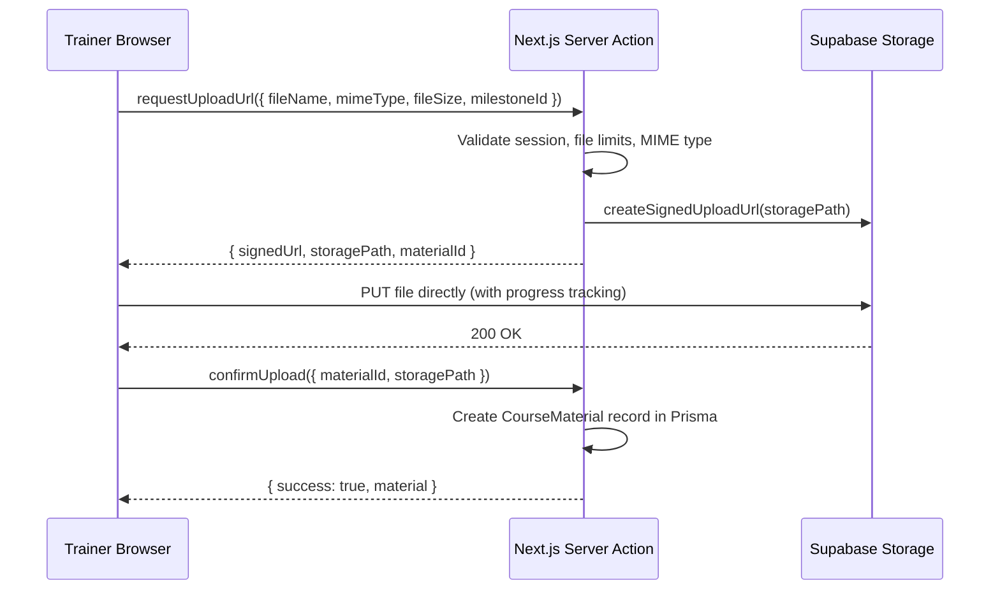

# Revision Specification: BEAT Growth Passport Portal — Major Improvement Round
**Project:** The Bistro Group – Digital Growth Passport (BEAT Program)  
**Document:** `REVISION-SPEC-BISTRO-PORTAL.md`  
**Status:** Approved — Ready for Implementation  
**Date:** 2026-10-23  
**Decisions Locked:** 15/15  

---

## 1. Executive Summary

This document specifies the architectural decisions for 5 major revision requirements to the BEAT Growth Passport portal, based on direct trainer and L&D feedback. All decisions were resolved through structured technical review and are ready for implementation.

### Revision Requirements Overview

| # | Requirement | Scope |
|---|-------------|-------|
| 1 | Trainer Access & Dashboard Simplification | Hub dashboard, FAB, inline editing |
| 2 | Digital Stamping System & 3D Passport Sync | SVG stamps, SHA-256 hash, polling sync |
| 3 | Drag-and-Drop Course Material Creation | Supabase Storage, client-direct upload |
| 4 | UI/UX & Mobile Responsiveness | Mobile-first, Tailwind breakpoints |
| 5 | Editable Learning Paths & Progress Preservation | React Flow canvas, reconcile engine |

---

## 2. Architecture Decisions Record (ADR)

### ADR-01: Course Material Data Model
**Decision:** Attach `CourseMaterial` to `MilestoneDefinition` (library catalog level).

**Rationale:** Materials are authored once and reused across every plan version that references that milestone. A single `CourseMaterial` model with FK to `MilestoneDefinition` avoids duplication and ensures consistency when the same milestone appears in multiple training plans.

```prisma
model CourseMaterial {
  id                  String              @id @default(cuid())
  milestoneId         String
  fileName            String              // Original upload filename
  fileType            String              // "VIDEO" | "PDF" | "PRESENTATION"
  mimeType            String              // "video/mp4" | "application/pdf" | "application/vnd.openxmlformats-officedocument.presentationml.presentation"
  fileSizeBytes       Int
  storagePath         String              // Supabase Storage path: "{milestoneCode}/{materialId}/{filename}"
  displayOrder        Int                 @default(0)
  uploadedById        String
  createdAt           DateTime            @default(now())
  updatedAt           DateTime            @updatedAt

  milestone           MilestoneDefinition @relation(fields: [milestoneId], references: [id], onDelete: Cascade)
  uploadedBy          AdminUser           @relation(fields: [uploadedById], references: [id])

  @@index([milestoneId])
}
```

**Impact on existing schema:**
- Add `materials CourseMaterial[]` relation to `MilestoneDefinition`
- Add `uploadedMaterials CourseMaterial[]` relation to `AdminUser`

---

### ADR-02: Supabase Storage Bucket Strategy
**Decision:** Single bucket `course-materials` with structured folder prefixes.

**Folder Structure:**
```
course-materials/
  └── {milestoneCode}/
       └── {materialId}/
            └── {original-filename}
```

**Example:** `course-materials/ONB-01/clxyz123abc/orientation-deck.pdf`

**Benefits:**
- Single RLS policy to manage
- Simple folder cleanup on material deletion
- Milestone-scoped organization for easy auditing

---

### ADR-03: File Access Security — Signed URLs
**Decision:** Server-generated signed URLs with 1-hour expiry.

**Flow:**
1. Trainee requests to view a material → Next.js server action called
2. Server validates trainee session and plan assignment
3. Server generates signed URL via `supabase.storage.from('course-materials').createSignedUrl(path, 3600)`
4. Signed URL returned to client for rendering

**Security Properties:**
- Files are never publicly indexable
- URLs expire after 1 hour
- Server validates authorization before generating URLs

---

### ADR-04: Upload Mechanism — Client-Direct to Supabase
**Decision:** Client-side direct upload with server-generated signed upload URLs.

**Upload Flow:**


**File Validation Gates (dual-enforced client + server):**

Amended 2026-10-25: use Supabase Free with a 50 MB per-file limit for all three types, replacing the original 500 MB video / 100 MB presentation limits.

| File Type | MIME Types | Max Size |
|-----------|-----------|----------|
| MP4 Video | `video/mp4` | 50 MB |
| PDF Document | `application/pdf` | 50 MB |
| PPTX Presentation | `application/vnd.openxmlformats-officedocument.presentationml.presentation` | 50 MB |

---

### ADR-05: Trainer Dashboard Architecture — Hub + Deep Links
**Decision:** Add a unified hub dashboard at `/trainer` with summary widgets and quick actions. Existing routes (`/trainer/queue`, `/trainer/plans`, `/trainer/trainees`, `/trainer/batch`) remain as deep-link destinations.

**Hub Dashboard Structure:**
```
/trainer (NEW - Hub Dashboard)
  ├── Trainee Cohort Progress Heatmap
  │     └── Visual grid: % completion per cohort × brand
  ├── Quick-Action FAB (floating, bottom-right)
  │     ├── + New Course
  │     ├── + Register Trainee
  │     └── + Batch Sign-Off
  └── Navigation to existing sub-routes

/trainer/queue (existing - Verification Queue)
/trainer/plans (existing - Training Plans)
/trainer/plans/[id]/builder (existing - Canvas Builder)
/trainer/trainees (existing - Trainee Directory)
/trainer/batch (existing - Batch Sign-Off)
```

**Interaction Pattern:**
- **Inline edit panels** for list items (expanding accordion on click)
- **Drawers** only for complex multi-step forms (canvas builder)
- **Modals** eliminated in favor of inline panels where possible

---

### ADR-06: FAB (Floating Action Button) Design
**Decision:** Brand Gold (`#C29B38`) FAB fixed to bottom-right corner on all screen sizes.

**Behavior:**
- Default state: Circular button with `+` icon
- Tap/click: Expands stacked vertical menu with 3 action items
- Actions: `+ New Course`, `+ Register Trainee`, `+ Batch Sign-Off`
- Each action either opens a drawer (New Course → canvas) or navigates (Register → `/trainer/trainees/new`)
- Outside click or re-tap collapses the menu

**Styling:**
```css
/* FAB base */
background: #C29B38;
color: white;
border-radius: 50%;
box-shadow: 0 4px 12px rgba(0,0,0,0.15);

/* FAB menu items */
background: #5C1D24;
color: white;
border-radius: 8px;
```

---

### ADR-07: Digital Stamp Visual System
**Decision:** SVG-based stamp templates with a `stampDesign` field on `PlanNode`.

**Stamp Design Catalog (static TypeScript map):**
```typescript
export const STAMP_DESIGNS = {
  ONBOARDING_SEAL: { label: "Onboarding", icon: "BookOpen", borderPattern: "dotted-circle", accentColor: "#C29B38" },
  COMMUNICATION_BADGE: { label: "Communication", icon: "MessageCircle", borderPattern: "speech-bubble", accentColor: "#C29B38" },
  TECHNICAL_GEAR: { label: "Technical", icon: "Wrench", borderPattern: "gear-teeth", accentColor: "#C29B38" },
  CULTURE_STAR: { label: "Culture", icon: "Star", borderPattern: "star-burst", accentColor: "#C29B38" },
  LEADERSHIP_CREST: { label: "Leadership", icon: "Crown", borderPattern: "shield", accentColor: "#C29B38" },
  BARISTA_BADGE: { label: "Barista", icon: "Coffee", borderPattern: "cup-ring", accentColor: "#C29B38" },
  KITCHEN_BADGE: { label: "Kitchen", icon: "ChefHat", borderPattern: "flame", accentColor: "#C29B38" },
  SERVICE_BADGE: { label: "Service", icon: "Heart", borderPattern: "ribbon", accentColor: "#C29B38" },
} as const;

export type StampDesignKey = keyof typeof STAMP_DESIGNS;
```

**Schema Addition:**
```prisma
// Add to PlanNode model:
  stampDesign    String    @default("ONBOARDING_SEAL") // StampDesignKey enum value
```

**Rendering:** Inline SVG components using Lucide icons as the center motif, with decorative border patterns rendered as SVG paths. Mockup quality for now — real brand assets will replace SVG templates later.

---

### ADR-08: Stamp Tooltip — Rich Metadata Display
**Decision:** Rich tooltip showing all 6 verification metadata fields.

**Tooltip Fields:**
1. **Trainer Name** — Full name of the verifying trainer
2. **Verification Date/Time** — Formatted timestamp of when the stamp was issued
3. **Verification Hash** — Truncated SHA-256 (first 8 characters)
4. **Milestone Code + Title** — e.g., "ONB-01: Company Orientation"
5. **Trainee Reflection Note** — The trainee's submitted reflection (if any)
6. **Trainer Feedback Note** — The trainer's feedback (if any)

**Hash Generation (at verification time):**
```typescript
import { createHash } from "crypto";

function generateVerificationHash(
  traineeId: string,
  planNodeId: string,
  verifiedBy: string,
  verifiedAt: Date
): string {
  const payload = `${traineeId}:${planNodeId}:${verifiedBy}:${verifiedAt.toISOString()}`;
  return createHash("sha256").update(payload).digest("hex");
}
```

**Schema Addition:**
```prisma
// Add to TraineeProgress model:
  verificationHash  String?   // SHA-256 hash generated at verification time
```

**Tooltip Component:** Custom Tailwind-styled popover (no external tooltip library), triggered on hover (desktop) or tap (mobile).

---

### ADR-09: Stamp Sync to 3D Passport — Optimistic Revalidation
**Decision:** `revalidatePath` + 30-second client-side polling on the trainee dashboard.

**Sync Flow:**
1. Trainer verifies milestone → server action calls `revalidatePath('/trainee/dashboard')`
2. Trainee's open dashboard has a `useEffect` with 30-second `setInterval`
3. Each interval calls a lightweight server action: `checkForNewStamps(lastKnownTimestamp)`
4. If new stamps detected → `router.refresh()` + toast notification: "🎉 New stamp earned!"
5. Passport flip-book re-renders with the new stamp visible

**No new infrastructure required** — works with existing Next.js server actions and App Router.

---

### ADR-10: Learning Path Editing — Reuse React Flow Canvas
**Decision:** All path editing (rename, reorder, add/remove milestones) uses the existing `@xyflow/react` canvas.

**No new dependencies.** The [`PlanCanvasBuilder`](file:///Users/genesisjim/Codes/Passport-TBG/components/canvas/PlanCanvasBuilder.tsx) component already supports:
- Drag-and-drop node positioning
- Edge creation/deletion
- Custom node types ([`PathRootNode`](file:///Users/genesisjim/Codes/Passport-TBG/components/canvas/nodes/PathRootNode.tsx), [`MilestoneNode`](file:///Users/genesisjim/Codes/Passport-TBG/components/canvas/nodes/MilestoneNode.tsx))
- Dagre auto-layout
- Version publishing with reconciliation

**Enhancements needed:**
- Add inline rename capability on `PathRootNode` (double-click to edit path name)
- Add drag handle on `MilestoneNode` for reorder within a path group
- Add `+ Add Milestone` button on `PathRootNode`

---

### ADR-11: Path Rename — Progress Preservation via Node Identity Matching
**Implementation amendment (2026-10-25):** Keep the five canonical `PlanNode.path` identifiers stable and store editable display names in nullable `PlanVersion.pathTitles` JSON. This additive field is needed to persist names for empty paths as well as populated paths; the original no-schema-change assumption did not account for empty paths and fixed-key validation/rendering.

Both canvas hubs and the mobile outline edit these version-specific display names. Published snapshots retain their own names. Passport summaries render the active version's display names while the category keys still drive ordering, styles, library filtering and stamp defaults.

Progress identity matches case-insensitive `code` first and `libraryMilestoneId` second, one to one. Neither display names nor order are identity inputs. Matched progress is remapped **in place**, preserving its ID, creation time, statuses, notes, approval dates and original verification hash. Removed milestones are soft-archived with `REMOVED_FROM_UPDATED_PLAN`; progress records are never deleted by reconciliation.

Publishing with sync includes active subscribers on every older version of the plan, including versions left behind by an earlier publish without sync. The publish and reconciliation operation is transactional.
---

### ADR-12: Mobile Responsiveness — Tailwind Default Breakpoints
**Decision:** Standard Tailwind breakpoints with mobile-first CSS.

| Breakpoint | Width | Behavior |
|-----------|-------|----------|
| Default (mobile) | `< 640px` | Single column, stacked cards, vertical scroll passport, accordion tree for canvas |
| `sm` | `≥ 640px` | Two-column grids begin, compact passport cards |
| `md` | `≥ 768px` | 3D flip-book enabled, canvas builder interactive, sidebar navigation |
| `lg` | `≥ 1024px` | Full desktop layout, heatmap grid expands |
| `xl` | `≥ 1280px` | Max-width container, spacious padding |

**Degradation Rules:**
- **3D Passport Flip-Book**: Interactive page-turning on `≥ md`, vertical scrollable card stack on `< md`
- **Canvas Builder**: Interactive zoom/pan on `≥ md`, accordion tree with drag handles on `< md`
- **Hub Dashboard Heatmap**: Full grid on `≥ lg`, simplified list on `< lg`

---

### ADR-13: Course Material Preview Modal
**Decision:** Native browser rendering, zero external dependencies.

| File Type | Preview Method | Fallback |
|-----------|---------------|----------|
| MP4 Video | `<video>` element with native controls | Download link |
| PDF Document | `<iframe>` or `<embed>` with signed URL as `src` | Download link |
| PPTX Presentation | File metadata card (name, size, type icon) + download button | — |

**Preview Modal Layout:**
- Full-width modal overlay with `max-w-4xl` container
- File title and metadata header
- Preview area (video player / PDF viewer / metadata card)
- Action buttons: Download, Delete (admin only), Close

---

### ADR-14: Testing Strategy — TSX Script Continuity
**Decision:** Continue with existing `tsx` script-based testing. Add targeted scripts per revision.

**New Test Scripts:**
| Script | Tests |
|--------|-------|
| `scripts/test_file_upload.ts` | CourseMaterial CRUD, signed URL generation, file validation gates |
| `scripts/test_stamp_sync.ts` | Stamp verification, hash generation, revalidation trigger |
| `scripts/test_path_edit_reconcile.ts` | Path rename + reconcile, milestone add/remove + progress preservation |
| `scripts/test_hub_dashboard.ts` | Heatmap data aggregation, FAB action routing |
| `scripts/test_material_preview.ts` | Signed URL generation for each file type |

---

### ADR-15: Dependency Additions
**Decision:** Minimal — only `@supabase/supabase-js`.

```bash
npm install @supabase/supabase-js
```

**No other new dependencies.** All UI components (tooltips, toasts, tabs, FAB, drawers) built with Tailwind CSS + custom React components using existing Lucide icons.

**Environment Variables to Add:**
```env
NEXT_PUBLIC_SUPABASE_URL=https://your-project.supabase.co
NEXT_PUBLIC_SUPABASE_ANON_KEY=your-anon-key
SUPABASE_SERVICE_ROLE_KEY=your-service-role-key  # Server-side only, for signed URLs
```

---

## 3. Updated Database Schema (Complete)

```prisma
datasource db {
  provider  = "postgresql"
  url       = env("DATABASE_URL")
  directUrl = env("DIRECT_URL")
}

generator client {
  provider = "prisma-client-js"
}

model AdminUser {
  id           String      @id @default(cuid())
  employeeId   String      @unique
  fullName     String
  email        String      @unique
  passwordHash String
  role         String      @default("TRAINER")
  createdAt    DateTime    @default(now())
  updatedAt    DateTime    @updatedAt

  verifications     TraineeProgress[]
  authoredPlans     TrainingPlan[]
  publishedVersions PlanVersion[]
  assignedTrainees  TraineePlanAssignment[]
  uploadedMaterials CourseMaterial[]          // NEW
}

model Trainee {
  id              String      @id @default(cuid())
  traineeCode     String      @unique
  fullName        String
  email           String
  restaurantBrand String
  branchLocation  String
  cohortBatch     String
  jobRole         String?
  hireDate        DateTime
  createdAt       DateTime    @default(now())
  updatedAt       DateTime    @updatedAt

  planAssignments TraineePlanAssignment[]
  progressRecords TraineeProgress[]

  @@index([traineeCode, email])
  @@index([restaurantBrand, branchLocation, cohortBatch])
}

model MilestoneDefinition {
  id          String      @id @default(cuid())
  path        String
  orderIndex  Int         @default(1)
  code        String      @unique
  title       String
  description String
  isStandard  Boolean     @default(true)
  createdAt   DateTime    @default(now())
  updatedAt   DateTime    @default(now()) @updatedAt

  planNodes   PlanNode[]
  materials   CourseMaterial[]              // NEW
}

// NEW MODEL
model CourseMaterial {
  id              String              @id @default(cuid())
  milestoneId     String
  fileName        String
  fileType        String              // "VIDEO" | "PDF" | "PRESENTATION"
  mimeType        String
  fileSizeBytes   Int
  storagePath     String              // Supabase Storage path
  displayOrder    Int                 @default(0)
  uploadedById    String
  createdAt       DateTime            @default(now())
  updatedAt       DateTime            @updatedAt

  milestone       MilestoneDefinition @relation(fields: [milestoneId], references: [id], onDelete: Cascade)
  uploadedBy      AdminUser           @relation(fields: [uploadedById], references: [id])

  @@index([milestoneId])
}

model TrainingPlan {
  id              String      @id @default(cuid())
  title           String
  roleIdentifier  String
  restaurantBrand String?
  description     String?
  isDefault       Boolean     @default(false)
  status          String      @default("DRAFT")
  createdById     String
  createdAt       DateTime    @default(now())
  updatedAt       DateTime    @updatedAt

  createdBy       AdminUser     @relation(fields: [createdById], references: [id])
  versions        PlanVersion[]

  @@index([roleIdentifier])
}

model PlanVersion {
  id              String      @id @default(cuid())
  planId          String
  versionNumber   Int
  status          String      @default("PUBLISHED")
  changelog       String?
  publishedById   String
  publishedAt     DateTime    @default(now())

  plan            TrainingPlan          @relation(fields: [planId], references: [id], onDelete: Cascade)
  publishedBy     AdminUser             @relation(fields: [publishedById], references: [id])
  nodes           PlanNode[]
  edges           PlanEdge[]
  assignments     TraineePlanAssignment[]

  @@unique([planId, versionNumber])
}

model PlanNode {
  id                  String               @id @default(cuid())
  planVersionId       String
  libraryMilestoneId  String?
  path                String
  code                String
  title               String
  description         String
  orderIndex          Int
  posX                Float
  posY                Float
  isCustom            Boolean              @default(false)
  stampDesign         String               @default("ONBOARDING_SEAL") // NEW — StampDesignKey
  createdAt           DateTime             @default(now())

  planVersion         PlanVersion          @relation(fields: [planVersionId], references: [id], onDelete: Cascade)
  libraryMilestone    MilestoneDefinition? @relation(fields: [libraryMilestoneId], references: [id], onDelete: SetNull)
  
  outgoingEdges       PlanEdge[]           @relation("SourceEdges")
  incomingEdges       PlanEdge[]           @relation("TargetEdges")
  progressRecords     TraineeProgress[]

  @@index([planVersionId, path])
}

model PlanEdge {
  id            String      @id @default(cuid())
  planVersionId String
  sourceNodeId  String
  targetNodeId  String
  edgeType      String      @default("PARENT_CHILD")

  planVersion   PlanVersion @relation(fields: [planVersionId], references: [id], onDelete: Cascade)
  sourceNode    PlanNode    @relation("SourceEdges", fields: [sourceNodeId], references: [id], onDelete: Cascade)
  targetNode    PlanNode    @relation("TargetEdges", fields: [targetNodeId], references: [id], onDelete: Cascade)

  @@unique([planVersionId, sourceNodeId, targetNodeId])
}

model TraineePlanAssignment {
  id            String      @id @default(cuid())
  traineeId     String
  planVersionId String
  assignedById  String
  assignedAt    DateTime    @default(now())
  status        String      @default("ACTIVE")

  trainee       Trainee     @relation(fields: [traineeId], references: [id], onDelete: Cascade)
  planVersion   PlanVersion @relation(fields: [planVersionId], references: [id], onDelete: Restrict)
  assignedBy    AdminUser   @relation(fields: [assignedById], references: [id])

  @@unique([traineeId, planVersionId])
  @@index([traineeId, status])
}

model TraineeProgress {
  id                String            @id @default(cuid())
  traineeId         String
  planNodeId        String
  status            String            @default("IN_PROGRESS")
  traineeNote       String?
  requestedAt       DateTime?
  
  verifiedBy        String?
  verifiedAt        DateTime?
  trainerNote       String?
  verificationHash  String?           // NEW — SHA-256 tamper-evidence hash
  
  isArchived        Boolean           @default(false)
  archivedReason    String?

  createdAt         DateTime          @default(now())
  updatedAt         DateTime          @updatedAt

  trainee           Trainee           @relation(fields: [traineeId], references: [id], onDelete: Cascade)
  planNode          PlanNode          @relation(fields: [planNodeId], references: [id], onDelete: Restrict)
  verifier          AdminUser?        @relation(fields: [verifiedBy], references: [id])

  @@unique([traineeId, planNodeId])
  @@index([status])
}
```

### Schema Changes Summary (diff from current)

| Change | Model | Field/Relation | Type |
|--------|-------|---------------|------|
| **NEW MODEL** | `CourseMaterial` | — | Entire new model |
| **NEW FIELD** | `PlanNode` | `stampDesign` | `String @default("ONBOARDING_SEAL")` |
| **NEW FIELD** | `TraineeProgress` | `verificationHash` | `String?` |
| **NEW RELATION** | `MilestoneDefinition` | `materials` | `CourseMaterial[]` |
| **NEW RELATION** | `AdminUser` | `uploadedMaterials` | `CourseMaterial[]` |

---

## 4. Component Architecture Map

```mermaid
flowchart TD
    subgraph TrainerPortal ["Trainer Portal Routes"]
        Hub["/trainer — Hub Dashboard (NEW)"]
        Queue["/trainer/queue — Verification Queue"]
        Plans["/trainer/plans — Training Plans"]
        Builder["/trainer/plans/[id]/builder — Canvas Builder"]
        Trainees["/trainer/trainees — Trainee Directory"]
        TraineeDetail["/trainer/trainees/[id] — Trainee Detail"]
        Batch["/trainer/batch — Batch Sign-Off"]
        NewTrainee["/trainer/trainees/new — Register Trainee"]
    end

    subgraph HubComponents ["Hub Dashboard Components (NEW)"]
        Heatmap["CohortProgressHeatmap"]
        FAB["FloatingActionButton"]
        FABMenu["FABActionMenu"]
    end

    subgraph StampComponents ["Stamp System Components (ENHANCED)"]
        StampSVG["PassportStampSVG (SVG templates)"]
        StampTooltip["StampDetailTooltip (rich 6-field)"]
        StampPoll["useStampPolling (30s interval hook)"]
    end

    subgraph MaterialComponents ["Course Material Components (NEW)"]
        UploadZone["MaterialUploadZone (drag-and-drop)"]
        UploadProgress["UploadProgressBar"]
        PreviewModal["MaterialPreviewModal (video/pdf/pptx)"]
        MaterialList["MaterialListPanel (per milestone)"]
    end

    subgraph CanvasEnhancements ["Canvas Enhancements (ENHANCED)"]
        PathRename["PathRootNode — inline rename"]
        StampPicker["StampDesignPicker (node property)"]
        MaterialAttach["MaterialAttachButton (on MilestoneNode)"]
    end

    Hub --> Heatmap
    Hub --> FAB
    FAB --> FABMenu
    Builder --> PathRename
    Builder --> StampPicker
    Builder --> MaterialAttach
    MaterialAttach --> UploadZone
    UploadZone --> UploadProgress
    UploadZone --> PreviewModal
    Queue --> StampSVG
    Queue --> StampTooltip
```



---

## 5. API & Server Actions Map

### New Server Actions

| Action | File | Purpose |
|--------|------|---------|
| `requestUploadUrlAction` | `lib/actions/materials.ts` | Validates session + file limits, generates Supabase signed upload URL |
| `confirmUploadAction` | `lib/actions/materials.ts` | Creates `CourseMaterial` record after successful client upload |
| `deleteMaterialAction` | `lib/actions/materials.ts` | Deletes from Supabase Storage + Prisma record |
| `getMaterialSignedUrlAction` | `lib/actions/materials.ts` | Generates signed download URL for trainee viewing |
| `getHubDashboardDataAction` | `lib/actions/dashboard.ts` | Aggregates cohort progress heatmap data |
| `checkForNewStampsAction` | `lib/actions/progress.ts` | Lightweight poll: returns boolean if new stamps since timestamp |

### Enhanced Server Actions

| Action | File | Enhancement |
|--------|------|-------------|
| `verifyMilestoneAction` | `lib/actions/progress.ts` | Add SHA-256 `verificationHash` generation at verification time |
| `savePlanVersionAction` | `lib/actions/plans.ts` | Include `stampDesign` field in node persistence |

### New Repository Functions

| Function | File | Purpose |
|----------|------|---------|
| `createCourseMaterial` | `lib/db/repositories/materials.ts` | Prisma create for CourseMaterial |
| `deleteCourseMaterial` | `lib/db/repositories/materials.ts` | Prisma delete + return storagePath for cleanup |
| `getMaterialsForMilestone` | `lib/db/repositories/materials.ts` | Fetch materials by milestoneId |
| `getCohortProgressHeatmap` | `lib/db/repositories/dashboard.ts` | Aggregation query for heatmap widget |

---

## 6. Supabase Configuration

### Storage Bucket Setup
```sql
-- Create the course-materials bucket (run in Supabase Dashboard > SQL Editor)
INSERT INTO storage.buckets (id, name, public)
VALUES ('course-materials', 'course-materials', false);
```

### Environment Variables
```env
NEXT_PUBLIC_SUPABASE_URL=https://your-project.supabase.co
NEXT_PUBLIC_SUPABASE_ANON_KEY=your-anon-key
SUPABASE_SERVICE_ROLE_KEY=your-service-role-key
```

### Supabase Client Setup
```typescript
// lib/supabase/client.ts — Browser client (for direct uploads)
import { createClient } from "@supabase/supabase-js";

export const supabaseBrowser = createClient(
  process.env.NEXT_PUBLIC_SUPABASE_URL!,
  process.env.NEXT_PUBLIC_SUPABASE_ANON_KEY!
);

// lib/supabase/server.ts — Server client (for signed URLs, admin ops)
import { createClient } from "@supabase/supabase-js";

export const supabaseAdmin = createClient(
  process.env.NEXT_PUBLIC_SUPABASE_URL!,
  process.env.SUPABASE_SERVICE_ROLE_KEY!
);
```

---

## 7. File Validation Constants

```typescript
// lib/validations/materials.ts
export const MATERIAL_LIMITS = {
  VIDEO: {
    maxBytes: 50 * 1024 * 1024,      // 50 MB
    mimeTypes: ["video/mp4"],
    label: "MP4 Video",
  },
  PDF: {
    maxBytes: 50 * 1024 * 1024,      // 50 MB
    mimeTypes: ["application/pdf"],
    label: "PDF Document",
  },
  PRESENTATION: {
    maxBytes: 50 * 1024 * 1024,      // 50 MB
    mimeTypes: [
      "application/vnd.openxmlformats-officedocument.presentationml.presentation",
    ],
    label: "PPTX Presentation",
  },
} as const;

export type MaterialFileType = keyof typeof MATERIAL_LIMITS;

export function validateFile(file: File): { valid: boolean; error?: string; fileType?: MaterialFileType } {
  for (const [type, config] of Object.entries(MATERIAL_LIMITS)) {
    if (config.mimeTypes.includes(file.type)) {
      if (file.size > config.maxBytes) {
        return { valid: false, error: `${config.label} must be under ${config.maxBytes / (1024 * 1024)} MB` };
      }
      return { valid: true, fileType: type as MaterialFileType };
    }
  }
  return { valid: false, error: "Unsupported file type. Accepted: MP4, PDF, PPTX" };
}
```

---

## 8. Non-Destructive Editing Guarantee

The system's progress preservation guarantee is enforced at multiple levels:

1. **Node Identity Matching** ([`reconcile.ts`](file:///Users/genesisjim/Codes/Passport-TBG/lib/db/services/reconcile.ts)): Matches by `libraryMilestoneId` or `code`, never by path name or position.
2. **Soft Archival**: Deleted nodes get `isArchived: true` — never hard-deleted from `TraineeProgress`.
3. **Immutable Versions**: Each edit creates a new `PlanVersion`. Old versions are marked `SUPERSEDED`, never deleted.
4. **Assignment Chain**: `TraineePlanAssignment` tracks version history with `ACTIVE` → `SUPERSEDED` transitions.
5. **Path Rename Safety**: Version-specific labels live in `PlanVersion.pathTitles`; canonical `PlanNode.path` keys remain stable and reconciliation ignores display names.

---

## 9. New Dependency

```json
{
  "dependencies": {
    "@supabase/supabase-js": "^2.x"
  }
}
```

No other dependencies added. All UI built with Tailwind CSS, Lucide icons, and custom React components.
