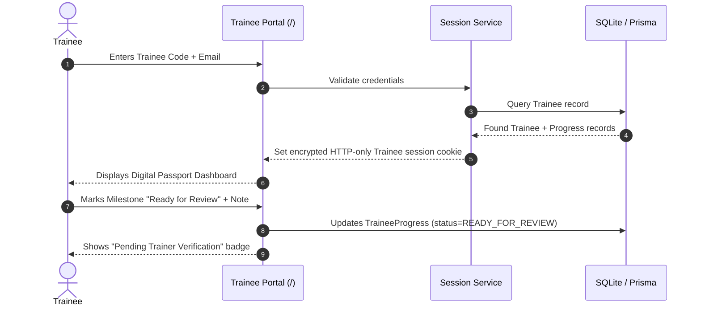
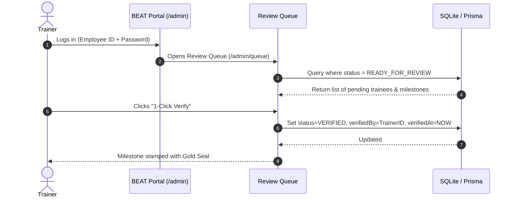

# Architecture Specification: The Bistro Group "Growth Passport"

## 1. System Overview & Architecture Goals
The **Growth Passport** is a lightweight, dual-access digital tracking portal for **The Bistro Group** (BEAT Program). It replaces legacy paper training booklets with an intuitive, tamper-resistant digital passport.

### Key Goals:
- **Low Barrier to Entry**: Trainees access their digital passport mirror at root (`/`) without passwords using their unique **Trainee Code + Email**.
- **High-Velocity Admin/Trainer Operations**: Trainers log in at `/admin` to review submissions, trigger 1-click approvals, and conduct cohort-wide bulk sign-offs for restaurant shifts.
- **Brand Consistency**: Adheres to the BEAT visual identity with Brand Maroon (`#5C1D24`), Brand Gold (`#C29B38`), and warm off-white canvas (`#FAF8F4`).
- **Pragmatic Evolution**: Built on local SQLite + Prisma for instant zero-config setup, designed for drop-in migration to Supabase PostgreSQL once the core workflows are validated.

---

## 2. Technology Stack

| Layer | Technology | Rationale |
| :--- | :--- | :--- |
| **Framework** | Next.js 14+ (App Router) | Monolithic structure with server-side rendering, API route handlers, and server actions. |
| **Language** | TypeScript (Strict) | End-to-end type safety between data layer and UI components. |
| **Styling** | Tailwind CSS | Utility-first styling configured with BEAT brand color tokens. |
| **UI Primitives** | shadcn/ui + Radix UI + Lucide Icons | Accessible, unstyled primitives for tables, modals, badges, and tabs. |
| **Database & ORM** | SQLite + Prisma ORM (v1) | Zero-setup local relational storage; seamless migration to Supabase (v2). |
| **Auth & Sessions** | `jose` (Encrypted HTTP-only cookies) + `bcryptjs` | Lightweight, secure session handling without external auth vendor dependencies. |
| **Validation** | Zod | Runtime schema validation for forms, session payloads, and API requests. |

---

## 3. Directory & Route Hierarchy

```
/
├── app/
│   ├── (trainee)/                  # Route Group: Trainee Passport Mirror (Root `/`)
│   │   ├── page.tsx                # Lookup landing page (Trainee Code + Email form)
│   │   ├── passport/
│   │   │   └── page.tsx            # Digital Passport dashboard & path progress
│   │   └── layout.tsx              # Trainee layout (minimalist header with BEAT logo)
│   │
│   ├── (admin)/                    # Route Group: BEAT Trainer Portal (`/admin`)
│   │   ├── admin/
│   │   │   ├── login/page.tsx      # Admin credentials login (Employee ID + Password)
│   │   │   ├── dashboard/page.tsx  # Overview metrics & quick actions
│   │   │   ├── queue/page.tsx      # Review Queue (milestones marked Ready for Review)
│   │   │   ├── trainees/
│   │   │   │   ├── page.tsx        # Trainee directory with brand/branch/cohort filters
│   │   │   │   └── [id]/page.tsx   # Detailed trainee passport view with 1-click approvals
│   │   │   ├── batch/page.tsx      # Batch attendance / bulk milestone sign-off tool
│   │   │   └── layout.tsx          # Admin layout (Maroon sidebar, user info, logout)
│   │
│   ├── api/                        # REST endpoints / Server Actions handlers
│   │   ├── auth/
│   │   │   ├── trainee/route.ts    # Trainee code+email verification & cookie issuance
│   │   │   ├── admin/route.ts      # Admin login & session creation
│   │   │   └── logout/route.ts     # Session clearance
│   │   ├── review-queue/route.ts   # Queue fetch & 1-click verification
│   │   └── batch/route.ts          # Bulk update transactions
│   ├── globals.css                 # BEAT CSS variables & utility classes
│   └── layout.tsx                  # Root HTML shell
│
├── components/
│   ├── ui/                         # shadcn primitives (button, dialog, badge, table, etc.)
│   ├── passport/                   # Passport-specific UI components
│   │   ├── PassportCover.tsx       # Trainee info header & overall completion ring
│   │   ├── PathSection.tsx         # Collapsible section for each of the 5 paths
│   │   ├── MilestoneCard.tsx       # Milestone status, notes, trainer gold stamp
│   │   └── ReadyForReviewModal.tsx # Trainee self-reporting modal with reflection note
│   └── admin/
│       ├── TraineeFilterBar.tsx    # Filter by Restaurant Brand, Branch, Cohort
│       ├── BulkActionModal.tsx     # Batch milestone sign-off confirmation
│       └── QueueItemRow.tsx        # Review queue action item with 1-click approve
│
├── lib/
│   ├── auth/                       # Session creation, cookie encryption, and middleware checks
│   │   └── session.ts
│   ├── db/
│   │   ├── prisma.ts               # Prisma client singleton
│   │   └── repositories/           # Isolated data queries (facilitates Supabase migration)
│   │       ├── trainee.ts
│   │       ├── milestone.ts
│   │       └── admin.ts
│   └── constants/
│       └── paths.ts                # Canonical definition of the 5 development paths
│
├── prisma/
│   ├── schema.prisma               # Relational database schema
│   ├── seed.ts                     # Barebones seed (1 sample admin, 1 sample trainee)
│   └── migrations/
└── tailwind.config.ts              # BEAT color palette configuration
```

---

## 4. Domain Data Model (Prisma Schema)

```prisma
datasource db {
  provider = "sqlite" // Easily swapped to "postgresql" for Supabase
  url      = env("DATABASE_URL")
}

generator client {
  provider = "prisma-client-js"
}

enum Role {
  TRAINER
  ADMIN
  SUPER_ADMIN
}

enum MilestoneStatus {
  LOCKED
  IN_PROGRESS
  READY_FOR_REVIEW
  VERIFIED
}

enum DevelopmentPath {
  ONBOARDING
  COMMUNICATION
  TECHNICAL
  CULTURE
  LEADERSHIP
}

model AdminUser {
  id           String      @id @default(cuid())
  employeeId   String      @unique
  fullName     String
  email        String      @unique
  passwordHash String
  role         Role        @default(TRAINER)
  createdAt    DateTime    @default(now())
  updatedAt    DateTime    @updatedAt
  
  verifications TraineeProgress[]
}

model Trainee {
  id              String      @id @default(cuid())
  traineeCode     String      @unique // e.g. "TBG-2024-001"
  fullName        String
  email           String
  restaurantBrand String      // e.g. "TGI Fridays", "Italianni's", "Texas Roadhouse"
  branchLocation  String      // e.g. "Bonifacio High Street", "Greenbelt"
  cohortBatch     String      // e.g. "Cohort-2024-Q4"
  hireDate        DateTime
  createdAt       DateTime    @default(now())
  updatedAt       DateTime    @updatedAt

  progressRecords TraineeProgress[]

  @@index([traineeCode, email])
  @@index([restaurantBrand, branchLocation, cohortBatch])
}

model MilestoneDefinition {
  id          String          @id @default(cuid())
  path        DevelopmentPath
  orderIndex  Int             // Linear sequence 1..N
  code        String          @unique // e.g. "ONB-01", "COMM-02"
  title       String
  description String
  createdAt   DateTime        @default(now())

  progressRecords TraineeProgress[]
}

model TraineeProgress {
  id             String            @id @default(cuid())
  traineeId      String
  milestoneId    String
  status         MilestoneStatus   @default(IN_PROGRESS)
  traineeNote    String?           // Reflection submitted when marking Ready for Review
  requestedAt    DateTime?
  
  verifiedBy     String?           // AdminUser ID
  verifiedAt     DateTime?
  trainerNote    String?
  
  createdAt      DateTime          @default(now())
  updatedAt      DateTime          @updatedAt

  trainee        Trainee           @relation(fields: [traineeId], references: [id], onDelete: Cascade)
  milestone      MilestoneDefinition @relation(fields: [milestoneId], references: [id], onDelete: Cascade)
  verifier       AdminUser?        @relation(fields: [verifiedBy], references: [id])

  @@unique([traineeId, milestoneId])
  @@index([status])
}
```

---

## 5. The 5 Development Paths (Uniform Milestones)

Each path contains a standard linear sequence of milestones:

### 1. Onboarding (`ONBOARDING`)
- `ONB-01`: Orientation & Bistro Group Company History
- `ONB-02`: Food Safety, Sanitation & Hygiene Standards
- `ONB-03`: Store Tour, Safety Equipment & Emergency Protocols
- `ONB-04`: First 30 Days Check-in & Buddy Alignment

### 2. Communication Skills (`COMMUNICATION`)
- `COMM-01`: Guest Welcoming & Table Greetings Etiquette
- `COMM-02`: Active Listening & Order Clarification
- `COMM-03`: Service Recovery & Resolving Guest Concerns
- `COMM-04`: Shift Handovers & Team Briefings

### 3. Technical Skills (`TECHNICAL`)
- `TECH-01`: POS & Order Entry Competency
- `TECH-02`: Menu Knowledge, Allergen Guide & Recipe Specs
- `TECH-03`: Table Service Sequence & Station Prep
- `TECH-04`: Station Closing, Auditing & Inventory Logs

### 4. Personal Effectiveness & Culture (`CULTURE`)
- `CULT-01`: Living Bistro Core Values & Teamwork Spirit
- `CULT-02`: Punctuality, Grooming & Uniform Standards
- `CULT-03`: Stress Management & High-Pace Service Agility
- `CULT-04`: Peer Support & Recognition Culture

### 5. Leadership Skills (`LEADERSHIP`)
- `LEAD-01`: Peer Mentorship & Buddy Coaching
- `LEAD-02`: Station Supervision & Shift Rush Support
- `LEAD-03`: Daily Briefing Facilitation
- `LEAD-04`: Growth Passport Capstone Evaluation

---

## 6. Detailed Workflows

### Trainee Flow


### Admin / Trainer Review & Verification Flow


### Admin Batch Attendance / Bulk Sign-Off Flow
1. Trainer navigates to `/admin/batch`.
2. Selects **Restaurant Brand** (e.g. *Texas Roadhouse*), **Branch** (e.g. *BGC*), and **Cohort Batch** (e.g. *Cohort-2024-Q4*).
3. System loads matching trainees in a multi-select table.
4. Trainer selects 1 or more trainees and selects the completed milestone (e.g., `ONB-02: Food Safety`).
5. Trainer clicks **"Bulk Sign Off (N trainees)"**.
6. System runs a transactional update setting all selected records to `VERIFIED` stamped with the trainer's credentials.

---

## 7. Migration Plan to Supabase (PostgreSQL)

When ready to graduate from local SQLite to Supabase:
1. **Environment Variable**: Change `DATABASE_URL` in `.env` from `"file:./dev.db"` to the Supabase PostgreSQL connection string.
2. **Prisma Provider**: Update `schema.prisma` datasource:
   ```prisma
   datasource db {
     provider = "postgresql"
     url      = env("DATABASE_URL")
   }
   ```
3. **Run Migration**: Execute `npx prisma migrate dev --name init_supabase`.
4. **Data Seed**: Execute `npm run db:seed` against the new database.
5. All queries in `lib/db/repositories/` remain 100% identical with zero application code changes.
